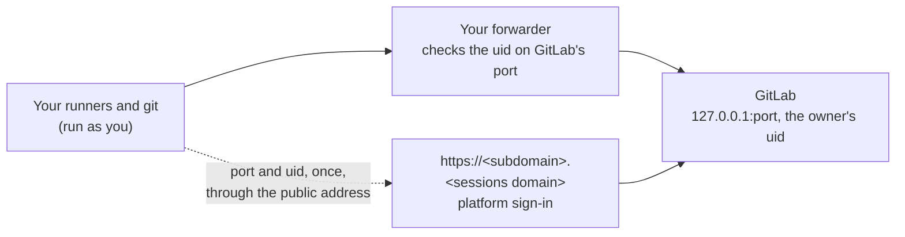

# GitLab

Runs a self-hosted [GitLab](https://about.gitlab.com/) (repositories, merge requests,
issues, CI/CD) on a cluster's login node, from the official image under Singularity or
Docker, and serves it as a `pw` endpoint on a fixed subdomain. Users sign in with their
ACTIVATE account. Pipelines run on the cluster through GitLab runners: on the login
node, or on the compute nodes through SLURM with
[Jacamar CI](https://gitlab.com/ecp-ci/jacamar-ci).

The workflow has two modes:

- **Start GitLab** starts GitLab and registers runners for a GitLab group of the user
  who launched it, **Group of the runners** in the form, `<username>-ci` by default.
  Every project in that group runs its pipelines on them.
- **Add my runners to a running GitLab** registers runners of the user who launched it
  with a GitLab already running on the same cluster, for one project or group of
  theirs.

A CI job runs as the Linux user whose runner took it, so a runner is never shared
between users. One user, the **owner**, runs *Start GitLab* and shares its session
with the others from the platform's sessions page. They can sign in, create projects
and push to them, but they have no runners: those who need pipelines run the workflow
again, on the same cluster, in *Add my runners* mode.

New to GitLab? The [tutorial](tutorial/README.md) takes you from a new project to
pipelines on the login node and on the compute nodes, and shows how a job uses the
`pw` client to run on any system connected to your ACTIVATE account, in about 30
minutes.

```
Start GitLab (the owner)
form ──► preprocessing ──► start script ──► GitLab answers, ──► https://<subdomain>.<sessions domain>/
         (checks, runner    (container,     group and runners    the run completes; GitLab and the
          tools)             runners)       registered           runners run until the session is deleted

Add my runners to a running GitLab (every other user)
form ──► preprocessing ──► start script ──► runners registered ──► a status page of the runners; the run
         (checks, runner    (finds the      and started            completes; the runners run until the
          tools)             GitLab's port)                        session is deleted
```

The first start of a run directory takes three to six minutes while GitLab configures
itself and creates its database. Later starts take two to four. The run completes once
the sign-in page answers and the runners are registered (until then the page answers
503 to the platform's probe). GitLab and its runners keep running until the session is
deleted. Adding runners takes under a minute.

## Two ways to run it

| Run container using | What runs | Needs |
|---|---|---|
| **Singularity** (default) | The official image rebuilt to run as **one unprivileged user** (`ghcr.io/parallelworks/gitlab:19.5.1-ee-rootless`, a SIF), as an Apptainer or Singularity instance that needs no root, subuid range or writable layer. Every service of the package (Puma, Sidekiq, Gitaly, PostgreSQL, Redis, nginx, GitLab's own SSH server) runs as you. If the login node cannot mount a SIF for an unprivileged user, the image is extracted once into `~/pw/software/containers/` and run from there | `apptainer`/`singularity` on the login node, 1.8 GB for the SIF |
| **Docker** | The official all-in-one image `gitlab/gitlab-ee:19.5.1-ee.0`, as root | Docker on the login node, directly or through `sudo`, 5 GB for the image |

Both need about 4 GB of free RAM for GitLab (8 GB recommended) and keep everything in
the **Run directory**. A run directory belongs to one runtime: Docker writes `config/`,
`data/` and `logs/` as root, Singularity writes everything as you, and each refuses the
other's directory. Under Singularity every file in the run directory is yours, so it
can live on any filesystem (local disk, NFS, Lustre, GPFS) and `rm -rf` removes it.
Hardened login nodes (a STIG image, FIPS mode, no FUSE mount of the SIF) work too, with
notices in the run's log.

## Signing in

With the two account variables of *Sign in with ACTIVATE* (below) set, users sign in
with their ACTIVATE account and need nothing else. GitLab's `root` account is for
administration. Its password is the one in the form, or the one the workflow generated
into `<run directory>/.root_password` (mode 600) when the form left it empty. The root
password is applied only when the database is created; change it in GitLab afterwards.

### Sign in with ACTIVATE

GitLab's OpenID Connect provider is in every edition, so this needs no license. The
workflow reads the application's client ID and secret from two **variables of your
ACTIVATE account**; the form has no field for them.

1. **An organization admin registers the GitLab address as an application**, once per
   address, and shares the client ID and the client secret with you. The application is
   registered for one exact redirect URI, built from the address the form's
   **Subdomain** sets: `https://<subdomain>.<sessions domain>/users/auth/openid_connect/callback`
   (`https://gitlab.activate.pw/users/auth/openid_connect/callback` with the default
   subdomain on activate.parallel.works; other platforms have other sessions domains).
   In Organization → Settings → Applications (behind the *OIDC Applications* preview
   of the account settings): a **web** application, consent none, scopes
   `openid profile email`, that redirect URI, and `https://<subdomain>.<sessions domain>/`
   as the post-logout redirect URI. The client secret is shown once when it is created;
   an admin can reveal it again. The same through the API:

   ```bash
   pw api -X POST organizations/<org>/oidc/apps --input - <<'EOF'
   {"name": "GitLab", "kind": "web", "consent": "none", "subjectType": "username",
    "scopes": ["openid", "profile", "email"],
    "redirectUris": ["https://<subdomain>.<sessions domain>/users/auth/openid_connect/callback"],
    "postLogoutRedirectUris": ["https://<subdomain>.<sessions domain>/"]}
   EOF
   pw api -X POST organizations/<org>/oidc/apps/<clientId>/secrets
   ```

   Reserve the subdomain too, so nobody else takes it: `pw subdomains reserve <label>`.
2. **Save the two values under Account → Variables**: `GITLAB_CLIENT_ID` with the
   client ID and `GITLAB_CLIENT_SECRET` with the client secret, the **Secret** toggle on
   for the latter. From a terminal: `pw variables --public -k GITLAB_CLIENT_ID --value
   pwapp_...` and `pw variables -k GITLAB_CLIENT_SECRET` (it prompts for the value and
   stores it as a secret). The workflow declares the variables it reads, so the platform
   asks you to grant it the secret on your first launch (`--trust` from the CLI).
3. **Launch.** GitLab's login page gets an **ACTIVATE** button and the session opens in
   a browser tab of its own, where the sign-in completes (it cannot inside the
   platform's embedded session view). The first sign-in creates the GitLab account
   (username = ACTIVATE username, email from the account). With **New users wait for
   approval** on, the account stays blocked until an administrator approves it under
   Admin → Users.

The provider is part of GitLab's configuration: a later run by a user without the two
variables removes the button, and the accounts it created stay. A run with only one of
them stops in preprocessing and says which is missing.

## CI/CD runners

A runner is a process that takes jobs from GitLab and runs them **as the Linux user
that started it**. A runner Jane started runs every job as Jane, with Jane's files,
cluster account and SLURM allocations, no matter which GitLab account pushed the
commit. So the workflow never shares a runner between users: each user's runners only
take jobs from that user's own projects.

| Who | Mode | The runners serve | Runner files |
|---|---|---|---|
| **The owner**, who starts GitLab | *Start GitLab* | the group named in **Group of the runners** (`<username>-ci` by default) | `<run directory>/runner/` |
| **Every other user** of that GitLab, and the owner for a project outside the group | *Add my runners to a running GitLab* | a project or group of theirs | **Runner directory** (`${HOME}/gitlab-runner`) |

Both modes register the same two runners. They run on the service host out of the
user's runner files (configuration, builds, cache, `runner.log`), which only that user
can read. The runner tokens are stored there too, so a later start on the same
directory reuses the registration:

| Runner | Executor | Jobs | What runs where |
|---|---|---|---|
| **shell** (tag `shell`, takes untagged jobs) | GitLab's shell executor | any | the whole job on the service host |
| **SLURM** (tag `slurm`) | GitLab's custom executor with Jacamar CI | `tags: [slurm]` | `before_script` + `script` inside an `sbatch` job; sources, artifacts and `after_script` on the service host |

How to write the jobs — the shell runner with the `pw` client, the SLURM runner's
`SCHEDULER_PARAMETERS` and id token, artifacts, schedules, when pipelines start — is
steps 1 to 5 of the [tutorial](tutorial/README.md).

### The owner's runners

The owner's runners are **group runners** of the group named in **Group of the
runners**: they take jobs from every project in that group, new ones included, and
from no project elsewhere in GitLab, so nothing outside the group can run as the
owner. Create your projects in the group. A project of yours outside it, in your
personal namespace (`<username>/<project>`) or in another group, has no runners until
you move it into the group (Settings → General → Advanced → Transfer project) or
launch *Add my runners to a running GitLab* for it, as any other user does.

The group is created on the first start, private. With *Sign in with ACTIVATE*
configured, the workflow makes the owner's GitLab account the group's Owner, creating
the account ahead of its first sign-in if needed. Without it, `root` owns the group.

Anyone who can push to a project in the group can run jobs as you. Share those
projects as carefully as your cluster account.

### Adding your runners to someone else's GitLab

You need an account on the cluster GitLab runs on and, unless the GitLab is yours, its
session shared with you (the owner does that from the platform's sessions page). Then:

1. Sign in with ACTIVATE and create a project.
2. Create a personal access token: avatar → Edit profile → Access tokens → Add new
   token, pick **Legacy token** (not a fine-grained one), tick the `api` and
   `create_runner` scopes and set the expiry to a day. GitLab shows the token once;
   copy it. Keep the expiry short: the platform keeps form values in the run's record.
3. Launch this workflow with **Add my runners to a running GitLab** on the same cluster:

   | Field | Value |
   |---|---|
   | Service host | the cluster GitLab runs on |
   | GitLab address | the address in your browser, `https://<subdomain>.<sessions domain>` |
   | GitLab personal access token | the token from step 2 |
   | Project or group | the full path of your project, namespace included (`jane/hpc-pipeline`, not `hpc-pipeline`), or of your group (`team-a`): everything after the GitLab address in the browser. You must be a Maintainer of the project or an Owner of the group |
   | Register a shell runner / a SLURM runner | as you need |

The run registers the runners for that project or group, starts them as you and serves
a status page as its session: which runners are up, where jobs run, whether GitLab is
reachable, the runner log. The runners keep running until you delete that session. A
later start on the same runner directory needs no token (keep the directory on a
persistent disk where home does not survive a restart: *Keeping the data across
cluster restarts*).

Your jobs run as you and are written like the owner's: steps 1 to 5 of the
[tutorial](tutorial/README.md) apply to your runners unchanged.

### How the runners reach GitLab

GitLab's public address sits behind the platform's sign-in, which a runner cannot
pass, so the runners use the port GitLab listens on, on the login node's loopback.
Every user of the node shares that port, and the workflow makes sure the process at
the other end is GitLab:

1. It asks GitLab for its port and the uid it runs as, through the public address.
   Only a GitLab this workflow started answers, and only for a user its session is
   shared with.
2. It starts a forwarder of its own, which the runner, Jacamar and `git` connect to.
   Before relaying a connection, the forwarder checks that the socket on GitLab's port
   still belongs to that uid (or to root, for a port Docker publishes).



If GitLab stops and another process takes the port, the forwarder refuses the
connection, and no runner token, job token or job variable reaches it. The status
page then shows GitLab as unreachable. A restarted GitLab listens on a new port, so
launch *Add my runners* again once it is back.

### Working on a project together

A project's pipelines run on the runners registered for it, as the user who started
them. If Alice owns the project and Bob can push to it, a commit of Bob's runs as
Alice, with whatever Bob put in `.gitlab-ci.yml`. To work together without that:

- Bob forks the project into his own namespace, adds his runners to the fork (*Add my
  runners*, with the fork's path) and works there. His pipelines run as him.
- Bob opens a merge request to Alice's project. Its pipeline runs in the fork, as Bob.
  Alice reviews the changes, `.gitlab-ci.yml` included, and merges. The pipeline on the
  merged branch runs as Alice, on code she approved.
- Alice protects the branch (Settings → Repository → Protected branches: Maintainers
  merge, no one pushes) and marks her runners protected (edit the runner under the
  group's Build → Runners, or the project's Settings → CI/CD → Runners, and tick
  **Protected**). They then only take jobs from protected branches, so a branch pushed
  straight into the project runs nothing as her.

Anyone can edit the pipelines this way; a change runs as the owner only once the owner
merges it.

## Git from the command line

The address in your browser sits behind the platform's sign-in, which `git` cannot
pass, so `git` does not use `https://<subdomain>.<sessions domain>`. It talks to the
ports GitLab listens on inside the cluster, reached from your machine through a tunnel.
An ACTIVATE account has no GitLab password, so `git` signs in with an SSH key (no
password ever asked) or with a personal access token in place of a password.

**With an SSH key.** Once, register your key: print it with `cat ~/.ssh/id_ed25519.pub`
(`ssh-keygen -t ed25519` creates one), then in GitLab avatar → **Edit profile** →
**SSH Keys** → **Add new key**, paste it, **Add key**. Then, every time:

1. In a terminal of its own, open the tunnel and leave it running (Ctrl-C closes it;
   `git` then answers "Connection refused"):

   ```bash
   pw forward -L 2222:localhost:2222 <cluster>      # the form's SSH port, fixed
   ```

2. In a second terminal, work as with any repository:

   ```bash
   git clone ssh://git@localhost:2222/<group>/<project>.git
   cd <project>
   echo "a change" >> README.md
   git commit -am "Edit the README"
   git push
   ```

   The first clone asks whether to trust the host's fingerprint; answer yes. Every push
   starts a pipeline, as any commit does.

**With a personal access token.** Create one under avatar → **Edit profile** →
**Access tokens** → **Add new token**: a Legacy token with the `write_repository`
scope. Open the tunnel to GitLab's HTTP port instead, the one the run's log prints
(it changes when GitLab restarts), and clone over HTTP; `git` asks for your username
and, as the password, the token:

```bash
pw forward -L 8080:localhost:<HTTP port> <cluster>
git clone http://localhost:8080/<group>/<project>.git
```

The password prompt shows nothing while you paste. "Access denied" means the token did
not arrive intact; `git config --global credential.helper osxkeychain` (macOS) stores
it after one good paste.

**From the cluster itself** (a terminal, JupyterLab or any session on it) there is no
tunnel: `git clone http://localhost:<HTTP port>/<group>/<project>.git` with the token,
or `ssh://git@localhost:<SSH port>/...` with a key of the cluster account. Both
runtimes bind the two ports on the login node's loopback only. The runners talk to
GitLab over that loopback as well, so pipelines need no tunnel.

## License

| Image | What you get |
|---|---|
| `gitlab/gitlab-ee:<version>-ee.0` (default) | the Free tier without a license; Premium or Ultimate features with one |
| `gitlab/gitlab-ce:<version>-ce.0` | the MIT-licensed Community Edition; takes no license |

Paste a license key (the contents of a `.gitlab-license`: a Premium or Ultimate
subscription, or a trial from GitLab's site) into **GitLab license**. The workflow
applies it once and remembers it in the run directory (`.license-*` markers). Later
runs may leave the field empty; a different key replaces the current one. Sign in with
ACTIVATE and the runners need no license.

## Keeping the data across cluster restarts

On a cloud cluster, attach a persistent disk to the cluster (in the cluster's
definition, or with `pw cluster attach-storage --cluster-uri pw://<user>/<cluster>
--storage-uri pw://<user>/<storage> --mount-point /gitlab`) and point **Run directory**
at a path on it, such as `/gitlab/gitlab`. Under Singularity everything in the run
directory is yours, so any mount point you can write to works. Nothing else has to
survive: the image and the runner tools cached under `~/pw/software` are downloaded
again when they are gone.

The same advice applies to runners added with *Add my runners to a running GitLab*:
their **Runner directory** defaults to `${HOME}/gitlab-runner`, and a re-created
cluster can come back with a fresh home. That loses the runners' tokens: the next
launch needs a new personal access token and registers new runners, and the old ones
sit offline in the project's runner list until deleted there. A runner directory on
the persistent disk, such as `/gitlab/runner-<username>`, relaunches with no token.
The owner's runners need nothing: their files live in the run directory.

After the cluster comes back, GitLab is down and its session shows `stopped` in the
sessions list. Delete that session (`pw endpoints delete <name>`; the workflow refuses
to start while it holds the subdomain), then launch again with the same run directory.
Projects, pipelines, artifacts, accounts and the runners' registration are back in two
to four minutes.
