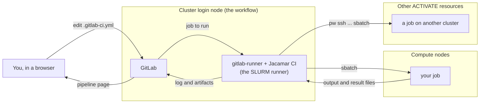
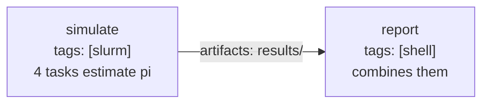
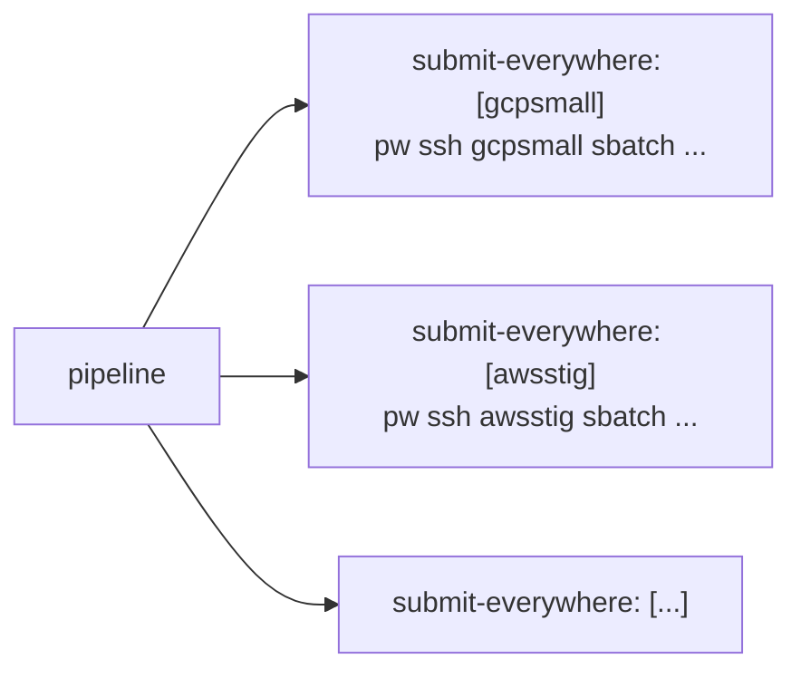

# Tutorial: run your code on the cluster from GitLab

In about 45 minutes you will launch a GitLab with the workflow, read the pipeline it
ships with, write a pipeline of your own whose jobs run on the cluster's compute nodes
through SLURM, make it run on its own (at every change and on a schedule), and reach
every other system of your ACTIVATE account from the same pipeline through the `pw`
CLI. No GitLab experience is needed; `sbatch` should ring a bell.



Five words GitLab uses:

| Word | Meaning |
|---|---|
| **project** | a repository plus everything around it (issues, pipelines, settings) |
| **pipeline** | one run of the project's automation, started by a commit, a schedule or a click |
| **job** | one unit of a pipeline: a script run by one runner; jobs in the same *stage* run in parallel |
| **runner** | a program that takes jobs from GitLab and runs them somewhere; a job picks its runner with **tags** |
| **`.gitlab-ci.yml`** | the file in the repository that defines the jobs |

The workflow registers two runners with your GitLab: a **shell** runner (tag `shell`)
that runs jobs on the login node, and a **SLURM** runner (tag `slurm`) that submits each
job with `sbatch`, through [Jacamar CI](https://gitlab.com/ecp-ci/jacamar-ci). Both run
as you, so a job can do what you can do on the cluster.

## Step 1: launch GitLab with the SLURM runner

In the ACTIVATE marketplace open the **GitLab** workflow and fill the form:

| Field | Set it to |
|---|---|
| Service host | a SLURM cluster of yours that is on |
| CI/CD runners → Register a SLURM runner | **on** (it only shows for SLURM clusters) |
| CI/CD runners → Create the hpc-ci-demo project | on (the default) |
| everything else | the defaults |

Launch. The first start takes five to ten minutes: GitLab creates its database, then
the workflow registers the runners and the demo project; the run completes when
GitLab's sign-in page answers. Open the endpoint the run shows (`pw endpoints list`
lists it too) **in its own browser tab**: GitLab does not work inside the platform's
embedded view.

Sign in as `root`. The workflow generated the password into the run directory on the
cluster:

```bash
pw ssh <cluster> cat gitlab/.root_password
```

## Step 2: read the pipeline that already ran

The demo project `hpc-ci-demo` is on your home page (**Projects**). Open it, then
**Build → Pipelines** in the left sidebar: one pipeline, started when the workflow
committed the project's files. Click its status badge to see its jobs:

- `hello-service-host`, run by the shell runner on the login node
- `hello-slurm`, run by the SLURM runner: click it. The log shows the `sbatch`
  submission, then `SLURM job <id> on <node>` and the node names `srun` printed.

The same job in SLURM's accounting, from your machine:

```bash
pw ssh <cluster> sacct -X --format=JobID,JobName%24,State,Elapsed,NodeList | tail -n 5
```

Now open the file that defined it: **Code → Repository**, `.gitlab-ci.yml`. The part
that matters:

```yaml
default:
  id_tokens:                    # every job needs this token: Jacamar uses it to talk to GitLab
    CI_JOB_JWT:
      aud: $CI_SERVER_URL

hello-slurm:
  tags: [slurm]                 # the SLURM runner
  variables:
    SCHEDULER_PARAMETERS: "--nodes=1 --time=00:10:00"   # the sbatch options, as one string
  script:                       # runs inside the SLURM job, on the compute node
    - echo "SLURM job $SLURM_JOB_ID on $SLURM_NODELIST"
    - srun hostname
```

Three things to remember: a job reaches the scheduler with `tags: [slurm]`, its `sbatch`
options go in `SCHEDULER_PARAMETERS` (`-o`, `-e`, `-J` and `--wait` are Jacamar's), and the
`default: id_tokens:` block at the top is required.

## Step 3: your first job on a compute node

1. **Create a project.** Click **+** at the top of the sidebar → **New project/repository**
   → **Create blank project**. Name it `hpc-pipeline`, leave *Initialize repository with a
   README* checked, click **Create project**.
2. **Add the pipeline file.** In the new project open **Code → Repository**, click the
   **+** above the file list → **New file**, name it `.gitlab-ci.yml` and paste the whole of
   [`01-hello-slurm.gitlab-ci.yml`](01-hello-slurm.gitlab-ci.yml). **Commit changes**.
3. **Watch it run.** The commit started a pipeline: **Build → Pipelines**. The job sits in
   *pending* until the runner picks it up (a few seconds), then *running* while SLURM
   queues and runs it: on a cloud cluster that powers nodes on when needed, the first job
   waits two or three minutes for a node to boot. Click the job to follow its log live.

When it is green, you have run a job on a compute node from a web page. Change a line,
commit, and it runs again.

## Step 4: compute on the cluster, report on the login node

Real work produces files. Open **Build → Pipeline editor**, which shows `.gitlab-ci.yml`
and checks it as you type, replace its contents with
[`02-simulate-and-report.gitlab-ci.yml`](02-simulate-and-report.gitlab-ci.yml) and
**Commit changes**. Its two stages:



- `simulate` runs on a compute node: `srun` starts one Python task per allocated core,
  each writing one line to `results/task-<n>.txt`. The `artifacts:` block tells GitLab to
  keep `results/` after the job.
- `report` runs on the login node, `needs: [simulate]`, so it starts as soon as the first
  job ends and gets its artifacts; it combines the lines into one estimate of pi and keeps
  `results/summary.txt`.

Open the pipeline: two jobs, one after the other. On the `report` job's page the right
column has **Job artifacts → Browse**: `summary.txt` is there, downloadable. The log
prints the estimate.

Run it with another input: **Build → Pipelines → New pipeline**, add the variable
`SAMPLES` with the value `10000000`, **New pipeline**. A variable set when a pipeline
starts takes precedence over the file's `variables:`, which is how one pipeline serves
many cases.

## Step 5: let it run on its own

- **At every change:** it already does. Any commit to the repository (the web editor, a
  `git push`) starts the pipeline.
- **On a schedule:** **Build → Pipeline schedules → New schedule**. Give it a description,
  an interval (`0 6 * * *` is every day at 06:00; the field has presets), your timezone
  and the branch, and **Create pipeline schedule**. The next runs appear under **Build →
  Pipelines** with a *scheduled* badge, each with its own artifacts.
- **By hand:** **Build → Pipelines → New pipeline**, optionally with variables, as in
  step 4.

A job's wall time counts against GitLab's job timeout too (one hour by default, under
**Settings → CI/CD → General pipelines**), queue time included.

## Step 6: one pipeline, every system

The SLURM runner reaches the cluster GitLab runs on. The shell runner, which runs on
that cluster's login node as you, can reach **any resource of your ACTIVATE account**
with the `pw` CLI, the same way you do from your laptop: `pw ssh <resource> sbatch ...`,
`pw workflows run ...`, `pw cluster ls`. A pipeline can therefore submit the same job to
several systems at once, or start a registered workflow on one of them.

1. **Give the project a credential.** `pw` on a cloud cluster is not signed in. Create
   an API key for your account (**Account → Authentication → API keys** in ACTIVATE)
   and store it in the project: **Settings → CI/CD → Variables → Add variable**, key
   `PW_API_KEY`, the key as value, **Mask variable** on, **Protect variable** on (jobs
   on the protected `main` branch see it, nothing else does). On an on-premises cluster
   connected through the ACTIVATE agent `pw` is already signed in as you; skip this.
2. **Add the job.** Replace `.gitlab-ci.yml` with
   [`03-every-system.gitlab-ci.yml`](03-every-system.gitlab-ci.yml) and put the names of
   two of your resources, as `pw cluster ls` prints them, in the `matrix:` list. They
   must be on. Commit.
3. **Watch the pipeline:** one job per resource, named `submit-everywhere: [gcpsmall]`,
   `submit-everywhere: [awsstig]`, ... Each signs in (`pw auth whoami`), submits a batch
   job to its resource with `sbatch --wait` through `pw ssh`, and prints the job's
   output when it ends.



`parallel: matrix:` is how one job definition becomes one job per value; the HPCMP
systems attached to your account are values like any other. Replace the `sbatch` line
with `pw workflows run <workflow> -i '{...}'` to launch a registered workflow instead,
or with an `rsync`/`scp` of the project's files before the submission; the job's log and
artifacts land in GitLab as before.

## Where things are

| | |
|---|---|
| GitLab, the runners | the cluster's login node, started by the workflow; they stay up after the run completes, until `pw endpoints delete gitlab-<run slug>` |
| A job's checkout on the cluster | shell runner: `~/gitlab/runner/builds/shell/<...>/<group>/<project>/`; SLURM runner: `~/gitlab/runner/jacamar/<you>/builds/<...>/<group>/<project>/`, on the shared home so the compute node sees it |
| The batch job's output | streamed into the job's log in GitLab; the runners' own log is `~/gitlab/runner/runner.log` |
| The job in SLURM | `squeue -u $USER` while it runs, `sacct` afterwards; its name starts with `ci-` |

## When a job does not run

| What you see | Why | What to do |
|---|---|---|
| The job stays *pending*; "This job is stuck because of one of the following problems" | no runner has its tag | Check `tags:`; relaunch the workflow with **Register a SLURM runner** on |
| `No id_token found on CI_JOB_JWT variable` | the `default: id_tokens:` block is missing | Copy it from the examples |
| `sbatch: error: ...` in the log | an option in `SCHEDULER_PARAMETERS` the cluster rejects (partition, time, account) | Try the same options with `sbatch` on the cluster |
| The job runs for an hour and fails with a timeout | the node took too long or the script hangs | Shorter `--time`, a higher job timeout, check `squeue` |
| `Running with gitlab-runner ...` then nothing for minutes | SLURM is booting or waiting for a node | `squeue -u $USER` on the cluster shows the job's state and reason |

## Going further

- **Software:** the job's script runs in your login shell on the compute node, so
  `module load ...`, `conda activate ...` and `singularity exec ...` work as they do in a
  batch script.
- **Several nodes, MPI:** `SCHEDULER_PARAMETERS: "--nodes=2 --ntasks-per-node=8 --time=01:00:00"`
  and `srun ./my_mpi_program` in the script.
- **Keep results:** `artifacts:` for files GitLab should keep and show; a copy to a
  project directory on the cluster in the script for large data.
- **PBS clusters:** Jacamar runs on PBS too (`qsub` options in `SCHEDULER_PARAMETERS`); the
  workflow registers the SLURM runner today. A PBS system is reached from a pipeline the
  step 6 way, `pw ssh <system> qsub ...`.
- The full reference: [GitLab CI/CD YAML](https://docs.gitlab.com/ci/yaml/) and
  [Jacamar CI](https://ecp-ci.gitlab.io/docs/admin/jacamar/introduction.html).
