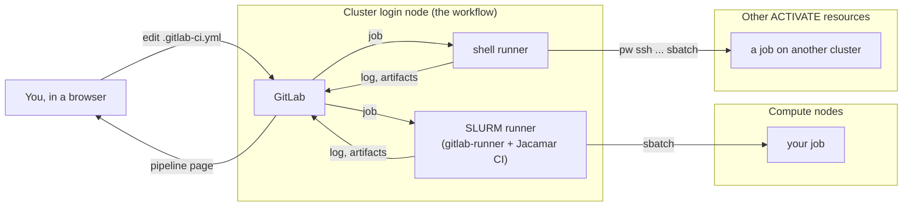
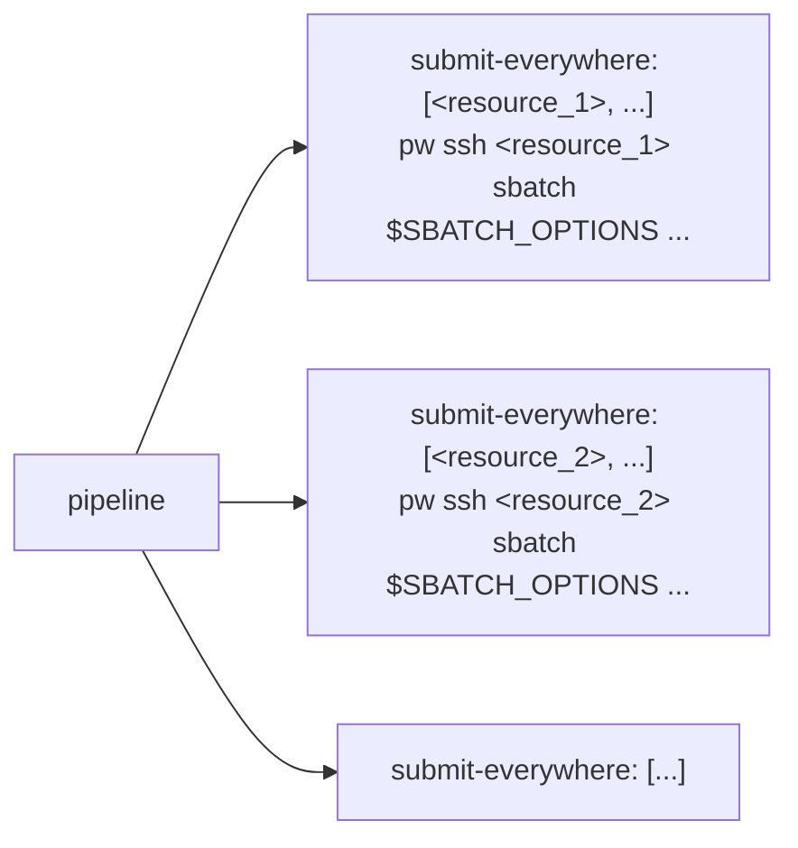
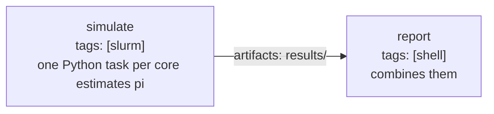

# Tutorial: run your code on the cluster from GitLab

In about 45 minutes you will launch a GitLab with the workflow, create a project and
run a first job on the cluster's login node, drive every other system of your ACTIVATE
account from a pipeline with the `pw` CLI, run jobs on the compute nodes through SLURM,
and make a pipeline run on its own, at every change and on a schedule. No GitLab
experience is needed; `sbatch` should ring a bell.



Five words GitLab uses:

| Word | Meaning |
|---|---|
| **project** | a repository plus everything around it (issues, pipelines, settings) |
| **pipeline** | one run of the project's automation. GitLab starts one after every commit to the repository, as long as it holds a `.gitlab-ci.yml`; a schedule or a click starts one too |
| **job** | one unit of a pipeline: a script run by one runner; jobs in the same *stage* run in parallel |
| **runner** | a program that takes jobs from GitLab and runs them somewhere; a job picks its runner with **tags** |
| **`.gitlab-ci.yml`** | the file at the root of the repository that defines the jobs |

The workflow registers two runners with your GitLab: a **shell** runner (tag `shell`)
that runs jobs on the login node, and a **SLURM** runner (tag `slurm`) that submits each
job with `sbatch`, through [Jacamar CI](https://gitlab.com/ecp-ci/jacamar-ci). Both run
as you, so a job can do what you can do on the cluster. The tutorial uses them in that
order: the shell runner alone, the shell runner with `pw`, then the SLURM runner.

Throughout, `<resource>` stands for the cluster you launch GitLab on, as `pw cluster ls`
names it. Where an example shows `sbatch` options, replace them with what your cluster
requires: many HPC systems want an account, a partition or a QoS on every job.

## Step 1: launch GitLab with both runners

In the ACTIVATE marketplace open the **GitLab** workflow and fill the form:

| Field | Set it to |
|---|---|
| Service host | a SLURM cluster of yours that is on |
| CI/CD runners → Register a shell runner | on (the default) |
| CI/CD runners → Register a SLURM runner | **on** (it only shows for SLURM clusters) |
| CI/CD runners → ACTIVATE API key | on a cloud cluster, an API key of yours (**Account → Authentication → API keys** in ACTIVATE); step 3 needs it. The field is not shown on a cluster connected through the ACTIVATE agent, where `pw` is signed in already |
| everything else | the defaults |

Launch. The first start takes five to ten minutes: GitLab creates its database, then
the workflow registers the runners; the run completes when GitLab's sign-in page
answers. Open the address the run shows **in its own browser tab**: GitLab does not work
inside the platform's embedded view.

Sign in as `root`. The workflow generated the password into the run directory on the
cluster; from your machine:

```bash
pw ssh <resource> cat gitlab/.root_password
```

## Step 2: a first job on the login node

1. **Create a project.** Click **+** at the top of the sidebar → **New project/repository**
   → **Create blank project**. Name it `hpc-pipeline`, leave *Initialize repository with a
   README* checked, click **Create project**.
2. **Add the pipeline file.** Open **Code → Repository**, click the **+** above the file
   list → **New file**, name it `.gitlab-ci.yml` and paste the whole of
   [`01-hello-login-node.gitlab-ci.yml`](01-hello-login-node.gitlab-ci.yml). Its comments
   explain every line: one job, `tags: [shell]`, a few commands. **Commit changes**.
3. **Watch it run.** Committing a `.gitlab-ci.yml` is all it takes: GitLab reads the file
   after every commit to the repository and starts a pipeline from it (the file itself
   can narrow that down with `rules:`, which these examples do not use). Open **Build →
   Pipelines**: one pipeline, started by your commit. Click its status badge, then the
   job `hello-login-node`. The log shows the runner taking the job
   (`Running with gitlab-runner ...`), the repository being fetched, your commands with
   their output, and `Job succeeded`.

The job ran on the login node, as you, in a fresh checkout of the repository under
`~/gitlab/runner/builds/shell/`. Change a line, commit, and it runs again.

## Step 3: the same runner reaches every system, with `pw`

The shell runner runs on the login node as you, so it can use the `pw` CLI the way you
do from your laptop: `pw cluster ls`, `pw ssh <resource> sbatch ...`,
`pw workflows run ...`. A pipeline can therefore submit the same job to several systems
at once, or start a registered workflow on one of them.

1. **The credential.** `pw` needs to be signed in on the login node after the workflow
   run has completed, when the run's own credential has stopped working. On a cloud
   cluster that is the **ACTIVATE API key** you gave the form in step 1: every job of
   the shell runner gets it as `PW_API_KEY`. On a cluster connected through the ACTIVATE
   agent, `pw` on the login node is signed in as you already. (A project can also carry
   a key of its own as a masked, protected CI/CD variable named `PW_API_KEY`, under
   **Settings → CI/CD → Variables**; it takes precedence.)
2. **Add the job.** Open **Build → Pipeline editor**, which shows `.gitlab-ci.yml` and
   checks it as you type, replace its contents with
   [`02-every-system.gitlab-ci.yml`](02-every-system.gitlab-ci.yml) and edit its
   `matrix:`: one entry per system, with the name as `pw cluster ls` prints it in place
   of `<resource_1>` and `<resource_2>` (they must be on) and that system's `sbatch`
   options in `SBATCH_OPTIONS`. **Commit changes**.
3. **Watch the pipeline:** one job per entry, named after the entry's values,
   `submit-everywhere: [<resource_1>, --nodes=1 --time=00:10:00]` and so on. Each signs
   in (`pw auth whoami`), submits a batch job to its system with `sbatch --wait` through
   `pw ssh`, and prints the job's output when it ends. A system that has to power a node
   on first takes a few minutes.



`parallel: matrix:` is how one job definition becomes one job per entry; the systems
attached to your account are entries like any other. Replace the `sbatch` line with
`pw workflows run <workflow> -i '{...}'` to launch a registered workflow instead, or with
an `rsync`/`scp` of the project's files before the submission; the job's log and
artifacts land in GitLab as before.

## Step 4: a job on a compute node, through the SLURM runner

For the cluster GitLab runs on there is a shorter way than `pw ssh`: the SLURM runner
turns a job into a batch job itself. Replace `.gitlab-ci.yml` with
[`03-hello-slurm.gitlab-ci.yml`](03-hello-slurm.gitlab-ci.yml) in the pipeline editor,
put the `sbatch` options your cluster requires into `SCHEDULER_PARAMETERS`, and commit.
Three things in the file are new:

```yaml
default:
  id_tokens:                    # every SLURM job needs this token: Jacamar uses it to talk to GitLab
    CI_JOB_JWT:
      aud: $CI_SERVER_URL       # this GitLab's address, e.g. https://gitlab-jane.activate.pw

variables:
  SCHEDULER_PARAMETERS: "--nodes=1 --ntasks=4 --time=00:10:00"   # the sbatch options, as one string

hello-slurm:
  tags: [slurm]                 # the SLURM runner
  script:                       # runs inside the SLURM job, on the compute node
    - echo "SLURM job $SLURM_JOB_ID on $SLURM_NODELIST"
    - srun hostname
```

A job reaches the scheduler with `tags: [slurm]`; its `sbatch` options go in
`SCHEDULER_PARAMETERS` (`-o`, `-e`, `-J` and `--wait` are Jacamar's); and the
`default: id_tokens:` block at the top is required for the SLURM runner.

**Read the job's log top to bottom.** Everything that happened to the job is on its page
(**Build → Pipelines**, the pipeline, the `hello-slurm` box):

1. `Running with gitlab-runner ...`: the runner on the login node took the job.
2. A *Preparing environment* section: Jacamar wrote the job's commands into a batch
   script and submitted it; `Submitted batch job <id>` is `sbatch`'s own answer. The job
   then waits for an allocation; on a cloud cluster that powers nodes on when needed,
   the first job waits two or three minutes for a node to boot.
3. The commands and their output, exactly as they ran on the compute node:
   `SLURM job <id> on <node>`, then the node names `srun hostname` printed.
4. `Slurm job ci-...: state: COMPLETED`: Jacamar asked SLURM how the batch job ended.
5. `Job succeeded`: GitLab marks the job green.

**The same job, seen from the cluster.** The batch job was an ordinary one, submitted as
you, so the cluster's own tools know it. Open a terminal on the cluster (`pw ssh
<resource>` from your machine, or a terminal session on it) and list recent jobs with
SLURM's accounting command:

```bash
sacct -X --format=JobID,JobName%24,State,Elapsed,NodeList | tail -n 5
```

The CI job is the one whose name starts with `ci-` followed by GitLab's job number.
While a job runs, `squeue -u $USER` shows it waiting or running like any other.

If the job is red, read the `sbatch` error in its log: an option the cluster requires
and did not get, or one it rejects, goes into `SCHEDULER_PARAMETERS`. Edit the file,
commit, and the new pipeline tells you.

## Step 5: compute on the cluster, report on the login node

Real work produces files. Replace `.gitlab-ci.yml` with
[`04-simulate-and-report.gitlab-ci.yml`](04-simulate-and-report.gitlab-ci.yml), with the
same `SCHEDULER_PARAMETERS` as in step 4, and commit. Its two stages:



- `simulate` runs on a compute node: `srun` starts one Python task per allocated core,
  each writing one line to `results/task-<n>.txt`. The `artifacts:` block tells GitLab to
  keep `results/` after the job.
- `report` runs on the login node, `needs: [simulate]`, so it starts as soon as the first
  job ends and gets its artifacts; it combines the lines into one estimate of pi and keeps
  `results/summary.txt`.

Open the pipeline: two jobs, one after the other. On the `report` job's page the right
column has **Job artifacts → Browse**: `summary.txt` is there, downloadable. The log
prints the estimate.

Run it with another input: **Build → Pipelines → New pipeline**, add the variable
`SAMPLES` with the value `10000000`, **New pipeline**. A variable set when a pipeline
starts takes precedence over the file's `variables:`, which is how one pipeline serves
many cases.

## Step 6: let it run on its own

- **At every change:** it already does. Any commit to the repository (the web editor, a
  `git push`) starts the pipeline.
- **On a schedule:** **Build → Pipeline schedules → New schedule**. Give it a description,
  an interval (`0 6 * * *` is every day at 06:00; the field has presets), your timezone
  and the branch, and **Create pipeline schedule**. The next runs appear under **Build →
  Pipelines** with a *scheduled* badge, each with its own artifacts.
- **By hand:** **Build → Pipelines → New pipeline**, optionally with variables, as in
  step 5.

A job's wall time counts against GitLab's job timeout too (one hour by default, under
**Settings → CI/CD → General pipelines**), queue time included.

## Where things are

| | |
|---|---|
| GitLab, the runners | the cluster's login node, started by the workflow; they stay up after the run completes, until the session is deleted |
| A job's checkout on the cluster | shell runner: `~/gitlab/runner/builds/shell/<...>/<group>/<project>/`; SLURM runner: `~/gitlab/runner/jacamar/<you>/builds/<...>/<group>/<project>/`, on the shared home so the compute node sees it |
| The batch job's output | streamed into the job's log in GitLab; the runners' own log is `~/gitlab/runner/runner.log` |
| The job in SLURM | `squeue -u $USER` while it runs, `sacct` afterwards; its name starts with `ci-` |

## When a job does not run

| What you see | Why | What to do |
|---|---|---|
| The job stays *pending*; "This job is stuck because of one of the following problems" | no runner has its tag | Check `tags:`; relaunch the workflow with **Register a SLURM runner** on |
| `No id_token found on CI_JOB_JWT variable` | the `default: id_tokens:` block is missing | Copy it from the examples |
| `sbatch: error: ...` in the log | an option the cluster rejects, or one it requires is missing (account, partition, QoS) | Try the same `sbatch` options by hand on the cluster, then put them in `SCHEDULER_PARAMETERS` (or `SBATCH_OPTIONS` in step 3) |
| `pw: ... no context configured` or `Authentication has expired` in a step 3 job | the runner has no credential | Relaunch the workflow with an **ACTIVATE API key**, or set `PW_API_KEY` as a project variable |
| The job runs for an hour and fails with a timeout | the node took too long or the script hangs | Shorter `--time`, a higher job timeout, check `squeue` |
| `Running with gitlab-runner ...` then nothing for minutes | SLURM is booting or waiting for a node | `squeue -u $USER` on the cluster shows the job's state and reason |

## Going further

- **Software:** the job's script runs in your login shell on the compute node, so
  `module load ...`, `conda activate ...` and `singularity exec ...` work as they do in a
  batch script.
- **Several nodes, MPI:** `SCHEDULER_PARAMETERS: "--nodes=2 --ntasks-per-node=8 --time=01:00:00"`
  and `srun ./my_mpi_program` in the script.
- **Keep results:** `artifacts:` for files GitLab should keep and show; a copy to a
  project directory on the cluster in the script for large data.
- **PBS clusters:** Jacamar runs on PBS too (`qsub` options in `SCHEDULER_PARAMETERS`); the
  workflow registers the SLURM runner today. A PBS system is reached from a pipeline the
  step 3 way, `pw ssh <system> qsub ...`.
- The full reference: [GitLab CI/CD YAML](https://docs.gitlab.com/ci/yaml/) and
  [Jacamar CI](https://ecp-ci.gitlab.io/docs/admin/jacamar/introduction.html).
