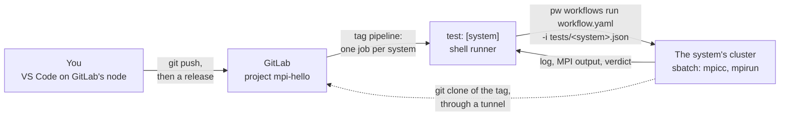

# Tutorial: a GitLab release that tests your code on every HPC system

A GitLab project holds an MPI hello world and its tests. An ACTIVATE workflow, a YAML
file in the same project, clones the code onto a cluster and runs it there through the
scheduler. You change the code, make a release, and the release's pipeline runs the
workflow on three systems at once. About 20 minutes; it assumes you use GitLab.



## Before you start

- **A GitLab served by this workflow** with its shell runner, where you are signed in
  with ACTIVATE: the workflow's [README](../../README.md). Its section *Keeping the
  data across cluster restarts* puts it on a persistent disk. The pipeline uses `git`
  and `jq` on that node.
- **VS Code on the node GitLab runs on**: `pw vscode <resource>` from your machine
  (it needs the `code` command and the Remote-SSH extension). Any terminal on that
  node works too.
- **Your systems switched on** in ACTIVATE. The examples use three: `jean` and
  `nautilus`, two HPC systems, and `aws`, a cloud cluster. All run SLURM.

Throughout, `<resource>` is the resource GitLab runs on and `<group>` your runners'
group in GitLab, `<username>-ci` unless you changed it.

## Step 1: the project

1. **Let the node push to GitLab.** In VS Code's terminal, print the node's public key
   with `cat ~/.ssh/id_rsa.pub` (`ssh-keygen` creates one) and add it in GitLab under
   avatar → **Edit profile** → **SSH Keys** → **Add new key**.
2. **Get the project's files**, which sit next to this file in [`mpi-hello/`](mpi-hello):

   ```bash
   git clone --depth 1 https://github.com/parallelworks/workflows.git
   cp -r workflows/workflows/gitlab/tutorial/activate-workflow-demo/mpi-hello ~/mpi-hello
   cd ~/mpi-hello
   ```

   | File | What it is |
   |---|---|
   | `hello.c` | the program: every MPI process prints one line |
   | `test.sh` | the test: builds the program, runs it on N processes, passes when all N answer |
   | `workflow.yaml` | the ACTIVATE workflow that runs the test on a cluster (step 2) |
   | `tests/<system>.json` | one file per system: how MPI is loaded there, the scheduler options |
   | `.gitlab-ci.yml` | the pipeline of a release: one job per system (step 3) |

3. **Make it yours.** Keep one file in `tests/` per system of yours, named after its
   resource as `pw cluster ls` prints it. In it, set the command that loads MPI there
   and the SLURM options the system requires (`<account>` in the two HPC examples). In
   `.gitlab-ci.yml`, list the same names under `SYSTEM:` and set `GITLAB_RESOURCE` to
   `<resource>`.
4. **Push it as a new project.** Pushing to a path that does not exist creates the
   project, private, in your runners' group:

   ```bash
   git config --global user.name "<your name>"
   git config --global user.email "<the email of your GitLab account>"
   git init -b main
   git add .
   git commit -m "MPI hello world, its test and the workflow that runs it"
   git remote add origin ssh://git@localhost:2222/<group>/mpi-hello.git
   git push -u origin main
   ```

   `2222` is the SSH port of the workflow's form.
5. **Protect the release tags and hand the pipeline a key**, both in the project's
   settings in GitLab:
   - **Settings → Repository → Protected tags**: protect `v*`, created by Maintainers.
   - **Settings → CI/CD → Variables → Add variable**: key `PW_API_KEY`, value an API key
     of yours (**Account → Authentication → API keys** in ACTIVATE), *Masked*, and
     *Protect variable* left ticked. Only the pipelines of protected tags get the key.

The push started no pipeline: `.gitlab-ci.yml` only runs for tags.

## Step 2: the workflow

Open `workflow.yaml` in VS Code. It is an ordinary ACTIVATE workflow, run from the file
(`pw workflows run <path>`) instead of being registered on the platform, so it is
versioned with the code it runs. Its two jobs run on the cluster's login node:

```yaml
jobs:
  clone:
    steps:
      - name: Open a tunnel to the GitLab node
        run: |
          port=$(pw agent open-port)
          setsid nohup pw forward -L 127.0.0.1:${port}:localhost:${{ inputs.gitlab.port }} ${{ inputs.gitlab.resource }} > forward.log 2>&1 < /dev/null &
          ...
        cleanup: kill "$(cat forward.pid)"
      - name: Clone the project
        uses: parallelworks/checkout
        with:
          repo: http://gitlab-ci-token:${{ inputs.gitlab.token }}@127.0.0.1:${{ needs.clone.outputs.TUNNEL_PORT }}/${{ inputs.gitlab.project }}.git
          branch: ${{ inputs.gitlab.ref }}
  test:
    steps:
      - name: Run the test
        uses: github/parallelworks/workflows@canary
        with:
          $yaml: workflows/script_submitter/v3.6/hsp.yaml
          script: |
            ${{ inputs.mpi.load }}
            bash test.sh ${{ inputs.mpi.processes }}
          ...
```

- **`clone`**: GitLab listens on its own node only, so the cluster opens a tunnel to
  that node with `pw forward` and clones the project through it, at the branch or tag
  it is given. The tunnel closes when the job ends.
- **`test`**: the script submitter runs the script as a SLURM job, or on the login node
  when `cluster.scheduler` is `false`, and a last step fails the run unless the test
  passed. `hsp.yaml` is the submitter of activate.hpc.mil; other platforms have their
  own next to it.

**The command that loads MPI is an input**, because every system has its own:

| System | Command that loads MPI |
|---|---|
| `jean` | `module load mpi/openmpi/4.1.5` |
| `nautilus` | `module load mpich/gnu/3.3.2` |
| `aws` | `module load mpi/openmpi-x86_64` |

That and the scheduler options are all a test file holds. `tests/jean.json`:

```json
{
  "mpi": {
    "load": "module load mpi/openmpi/4.1.5",
    "processes": 4
  },
  "cluster": {
    "scheduler": true,
    "slurm": {
      "account": "<account>",
      "qos": "normal",
      "time": "00:10:00"
    }
  }
}
```

## Step 3: change the code and release it

1. **Change the program.** In `hello.c`, change the greeting, say `Hello` to
   `Hello SC26`; keep it one line per process, which is what the test counts.
2. **Commit and push**, from VS Code's Source Control view or the terminal:

   ```bash
   git commit -am "Greet SC26"
   git push
   ```

3. **Make a release.** In GitLab: **Deploy → Releases → New release**. Type a new tag
   name, `v1.1.0`, choose **Create tag**, leave it created from `main`, add a title and
   release notes, and **Create release**.
4. **Watch the pipeline.** The release created the tag and the tag started a pipeline:
   **Build → Pipelines** shows it with three jobs, `test: [jean]`, `test: [nautilus]`
   and `test: [aws]`, running side by side.

Each job is the same few lines of `.gitlab-ci.yml`, run by the shell runner on GitLab's
node with `SYSTEM` set to its system:

```yaml
test:
  tags: [shell]
  parallel:
    matrix:
      - SYSTEM: [jean, nautilus, aws]
  script:
    - ...
    - |
      pw workflows run "$CI_PROJECT_DIR/workflow.yaml" -o json \
        -i "tests/$SYSTEM.json" \
        --input resource="pw://$(pw auth whoami)/$SYSTEM" \
        --input gitlab.ref="$CI_COMMIT_TAG" \
        --input gitlab.token="$CI_JOB_TOKEN" ... > run.json || { cat run.json; exit 1; }
    - RUN=$(jq -r .run.slug run.json)
    - pw workflows runs logs -f "$RUN"
    - test "$(pw workflows runs view "$RUN" -o json | jq -r .status)" = completed
```

Before a job's script runs, the runner clones the project at the released tag into
`$CI_PROJECT_DIR`. The job starts the workflow of that checkout with the system's test
file, follows the run's log and ends as the run ends. The cluster clones the same tag
with the job's own token (user name `gitlab-ci-token`), which GitLab revokes when the
job finishes, so no token is stored anywhere. Open a job and read its log top to
bottom: the clone of `v1.1.0`, the batch script, `Submitted batch job <id>`, then the
test on a compute node:

```
+ mpicc -o hello hello.c
+ mpirun -np 4 ./hello
Hello SC26 from rank 0 of 4 on <node>
Hello SC26 from rank 2 of 4 on <node>
Hello SC26 from rank 1 of 4 on <node>
Hello SC26 from rank 3 of 4 on <node>
...
::notice::The test passed on <system>
--- Run completed with status: completed ---
```

The same runs are on ACTIVATE's **Runs** page, named `mpi-hello v1.1.0 on <system>`.
A job waits as long as its system's queue does; a cloud cluster that powers nodes on
when needed adds a few minutes to its first job. A test that fails turns its job red:
fix, commit and release again. Canceling a job cancels its run and its batch job.
