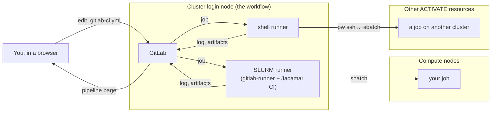
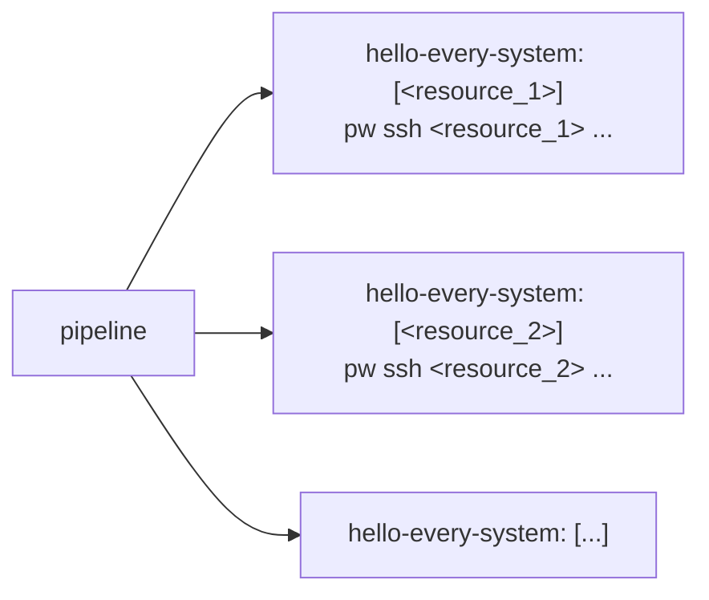
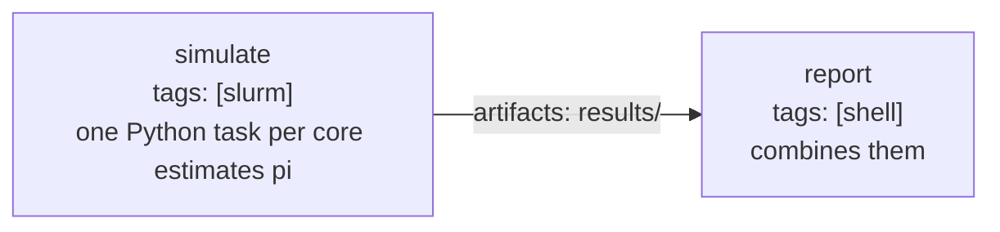

# Tutorial: run your code on the cluster from GitLab

In about 30 minutes you will create a project and run a first job on the cluster's
login node, drive every other system of your ACTIVATE account from a pipeline with the
`pw` CLI, run jobs on the compute nodes through SLURM, and make a pipeline run on its
own, at every change and on a schedule. No GitLab experience is needed; `sbatch`
should ring a bell.



Five words GitLab uses:

| Word | Meaning |
|---|---|
| **project** | a repository plus everything around it (issues, pipelines, settings) |
| **pipeline** | one run of the project's automation. GitLab starts one after every commit to the repository, as long as it holds a `.gitlab-ci.yml`; a schedule or a click starts one too |
| **job** | one unit of a pipeline: a script run by one runner; jobs in the same *stage* run in parallel |
| **runner** | a program that takes jobs from GitLab and runs them somewhere; a job picks its runner with **tags** |
| **`.gitlab-ci.yml`** | the file at the root of the repository that defines the jobs |

## Before you start

You need two things; the workflow's [README](../../README.md) covers both:

- **A GitLab served by this workflow.** Its owner launched it and shares it from the
  platform's sessions page. Open it **in its own browser tab** (it does not work
  inside the platform's embedded view) and sign in with the **ACTIVATE** button.
- **Your own runners on it**, shell and SLURM, since every job runs as the user whose
  runner takes it. Launching the workflow with **Register a shell runner** and
  **Register a SLURM runner** on registered both, serving your group `<username>-ci`.
  On a GitLab someone else launched you have none: create the project first (step 1),
  then register yours for it (the README's *Adding your runners to someone else's
  GitLab*).

Throughout, `<resource>` stands for the cluster GitLab runs on, as `pw cluster ls`
names it. Where an example shows `sbatch` options (steps 3 and 4), replace them with
what your cluster requires: many HPC systems want an account, a partition or a QoS on
every job.

## Step 1: a first job on the login node

1. **Create a project.** Click **+** at the top of the sidebar → **New project/repository**
   → **Create blank project**. Name it `hpc-pipeline` and pick its namespace under
   *Project URL*: your runners' group `<username>-ci` if you launched the workflow, any
   namespace of yours otherwise (you register your runners for it next, see *Before
   you start* above, with **Project or group** set to its full path,
   `<namespace>/hpc-pipeline`). Leave *Initialize repository with a README* checked,
   click **Create project**.
2. **Add the pipeline file.** Open **Code → Repository**, click the **+** above the file
   list → **New file**, and name it exactly `.gitlab-ci.yml`: a leading dot and nothing
   before it, the one file name GitLab looks for (the example files in this directory
   carry a number so they can sit side by side; the copy in your project does not). Paste
   the whole of [`01-hello-login-node.gitlab-ci.yml`](01-hello-login-node.gitlab-ci.yml).
   Its comments explain every line: one job, `tags: [shell]`, a few commands. **Commit
   changes**.
3. **Watch it run.** Committing a `.gitlab-ci.yml` is all it takes: GitLab reads the file
   after every commit to the repository and starts a pipeline from it — the default for
   any repository that holds the file; step 5 shows how to limit it to a schedule or a
   click. Open **Build →
   Pipelines**: one pipeline, started by your commit. Click its status badge, then the
   job `hello-login-node`. The log shows the runner taking the job
   (`Running with gitlab-runner ...`), the repository being fetched, your commands with
   their output, and `Job succeeded`.

The first line of output, `Running on <login node> as <user>`, names you, the runners'
owner, whoever committed: that is who every job of your runners runs as. The job ran
in a fresh checkout of the repository in your runner directory (*Where things are*,
below). Change a line, commit, and it runs again. The web editor is enough for the
tutorial; to clone the project to your laptop and push from there, see *Git from the
command line* in the workflow's [README](../../README.md).

## Step 2: the same runner reaches every system, with `pw`

The shell runner runs on the login node as you, so it can use the `pw`
CLI the way you do from your laptop: `pw cluster ls`, `pw ssh <resource> <command>`,
`pw workflows run ...`. A pipeline can therefore run a command on every system of your
ACTIVATE account, or start a registered workflow on one of them.

1. **The credential.** `pw` needs to be signed in on the login node after the workflow
   run has completed, when the run's own credential has stopped working. Give the
   project one of your API keys: **Settings → CI/CD → Variables → Add variable**, key
   `PW_API_KEY`, value an API key of yours (**Account → Authentication → API keys** in
   ACTIVATE), *Masked* ticked; every job of the shell runner gets it.
2. **Add the job.** Open **Build → Pipeline editor**, which shows `.gitlab-ci.yml` and
   checks it as you type, replace its contents with
   [`02-every-system.gitlab-ci.yml`](02-every-system.gitlab-ci.yml) and put the names of
   two of your resources, as `pw cluster ls` prints them, in place of `<resource_1>` and
   `<resource_2>`. They must be on. **Commit changes**.
3. **Watch the pipeline:** one job per resource, named `hello-every-system: [<resource_1>]`
   and `hello-every-system: [<resource_2>]`. Each prints where it runs, who `pw` is
   signed in as, and then the greeting its resource printed: `Hello from <that login
   node> as <user>`, brought back by `pw ssh`.



`parallel: matrix:` is how one job definition becomes one job per value; the systems
attached to your account are values like any other. The command behind `pw ssh` can be
anything you would type there: `sbatch --wait ...` or `qsub ...` to run a batch job on
that system and wait for it, `pw workflows run <workflow> -i '{...}'` to launch a
registered workflow, an `rsync` of the project's files first; the job's log and
artifacts land in GitLab as before.

## Step 3: a job on a compute node, through the SLURM runner

The SLURM runner submits to one system only: the SLURM cluster GitLab itself runs on,
where it was registered. Replace `.gitlab-ci.yml` with
[`03-hello-slurm.gitlab-ci.yml`](03-hello-slurm.gitlab-ci.yml) in the pipeline editor,
put the `sbatch` options your cluster requires into `SCHEDULER_PARAMETERS`, and commit.
Three things in the file are new:

```yaml
default:
  id_tokens:                    # every SLURM job needs this token: Jacamar uses it to talk to GitLab
    CI_JOB_JWT:
      aud: $CI_SERVER_URL       # this GitLab's address, e.g. https://gitlab.activate.pw

variables:
  SCHEDULER_PARAMETERS: "--nodes=1 --ntasks=4 --time=00:10:00"   # the sbatch options, as one string

hello-slurm:
  tags: [slurm]                 # the SLURM runner
  script:                       # runs inside the SLURM job, on the compute node
    - echo "SLURM job $SLURM_JOB_ID on $SLURM_NODELIST"
    - srun hostname
```

A job reaches the scheduler with `tags: [slurm]`; its `sbatch` options go in
`SCHEDULER_PARAMETERS` (`-o`, `-e`, `-J` and `--wait` are Jacamar's); and the
`default: id_tokens:` block at the top is required for the SLURM runner.

**Read the job's log top to bottom.** Everything that happened to the job is on its page
(**Build → Pipelines**, the pipeline, the `hello-slurm` box):

1. `Running with gitlab-runner ...`: the runner on the login node took the job.
2. A *Preparing environment* section: Jacamar wrote the job's commands into a batch
   script and submitted it; `Submitted batch job <id>` is `sbatch`'s own answer. The job
   then waits for an allocation; on a cloud cluster that powers nodes on when needed,
   the first job waits two or three minutes for a node to boot.
3. The commands and their output, exactly as they ran on the compute node:
   `Running on <node> as <user>`, `SLURM job <id> on <node>`, then the node names
   `srun hostname` printed.
4. `Slurm job ci-...: state: COMPLETED`: Jacamar asked SLURM's accounting (`sacct`)
   how the batch job ended. This is why the runner needs accounting on the cluster;
   the workflow refuses to register it where accounting is off.
5. `Job succeeded`: GitLab marks the job green.

**The same job, seen from the cluster.** The batch job was an ordinary one, submitted as
you, so the cluster's own tools know it. Open a terminal on the cluster (`pw ssh
<resource>` from your machine, or a terminal session on it) and list recent jobs with
SLURM's accounting command:

```bash
sacct -X --format=JobID,JobName%24,State,Elapsed,NodeList | tail -n 5
```

The CI job is the one whose name starts with `ci-` followed by GitLab's job number.
While a job runs, `squeue -u $USER` shows it waiting or running like any other.

If the job is red, read the `sbatch` error in its log: an option the cluster requires
and did not get, or one it rejects, goes into `SCHEDULER_PARAMETERS`. Edit the file,
commit, and the new pipeline tells you.

## Step 4: compute on the cluster, report on the login node

Real work produces files. Replace `.gitlab-ci.yml` with
[`04-simulate-and-report.gitlab-ci.yml`](04-simulate-and-report.gitlab-ci.yml), with the
same `SCHEDULER_PARAMETERS` as in step 3, and commit. Its two stages:



- `simulate` runs on a compute node: `srun` starts one Python task per allocated core,
  each writing one line to `results/task-<n>.txt`. The `artifacts:` block tells GitLab to
  keep `results/` after the job.
- `report` runs on the login node, `needs: [simulate]`, so it starts as soon as the first
  job ends and gets its artifacts; it combines the lines into one estimate of pi and keeps
  `results/summary.txt`.

Open the pipeline: two jobs, one after the other. On the `report` job's page the right
column has **Job artifacts → Browse**: `summary.txt` is there, downloadable. The log
prints the estimate.

Run it with another input: **Build → Pipelines → New pipeline**, add the variable
`SAMPLES` with the value `10000000`, **New pipeline**. A variable set when a pipeline
starts takes precedence over the file's `variables:`, which is how one pipeline serves
many cases.

## Step 5: let it run on its own

- **At every change:** it already does. Any commit to the repository (the web editor, a
  `git push`) starts the pipeline.
- **On a schedule:** **Build → Pipeline schedules → New schedule**. Give it a description,
  an interval (`0 6 * * *` is every day at 06:00; the field has presets), your timezone
  and the branch, and **Create pipeline schedule**. The next runs appear under **Build →
  Pipelines** with a *scheduled* badge, each with its own artifacts.
- **By hand:** **Build → Pipelines → New pipeline**, optionally with variables, as in
  step 4.

A `workflow` block at the top of `.gitlab-ci.yml` stops commits from starting
pipelines, leaving the schedule and the **New pipeline** button; `when: manual` on a
single job holds just that job for a click:

```yaml
workflow:
  rules:
    - if: '$CI_PIPELINE_SOURCE == "web" || $CI_PIPELINE_SOURCE == "schedule"'
```

A job's wall time counts against GitLab's job timeout too (one hour by default, under
**Settings → CI/CD → General pipelines**), queue time included.

## Where things are

| | |
|---|---|
| GitLab, the runners | the cluster's login node, started by the workflow; they stay up after the run completes, until the session is deleted |
| A job's checkout on the cluster | in your runner directory — `~/gitlab/runner/` when you launched the workflow, `~/gitlab-runner/` for added runners: `builds/shell/<...>/<group>/<project>/` (shell runner), `jacamar/<you>/builds/<...>/<group>/<project>/` (SLURM runner), on the shared home so the compute node sees it |
| The batch job's output | streamed into the job's log in GitLab; the runners' own log is `runner.log` in the runner directory |
| The job in SLURM | `squeue -u $USER` while it runs, `sacct` afterwards; its name starts with `ci-` |

## When a job does not run

| What you see | Why | What to do |
|---|---|---|
| The job stays *pending*; "This job is stuck because of one of the following problems" | no runner has its tag | Check `tags:`; register your runners again with **Register a SLURM runner** on |
| `No id_token found on CI_JOB_JWT variable` | the `default: id_tokens:` block is missing | Copy it from the examples |
| `sbatch: error: ...` in the log | an option the cluster rejects, or one it requires is missing (account, partition, QoS) | Try the same `sbatch` options by hand on the cluster, then put them in `SCHEDULER_PARAMETERS` (or `SBATCH_OPTIONS` in step 2) |
| A green SLURM job, but its artifacts never reach GitLab | Jacamar uploads them from the login node in a clean login shell, which must find `gitlab-runner`; the workflow links it into `~/bin`, and your login profile leaves `~/bin` off the PATH | The run's log warns about it; make your profile put `~/bin` on the PATH |
| `pw: ... no context configured` or `Authentication has expired` in a step 2 job | the runner has no credential | Set `PW_API_KEY` as a masked CI/CD variable of the project (step 2) |
| The job stays *pending* in a project your runners do not serve | runners only take jobs from the project or group they were registered for | Move it into your runners' group (Settings → General → Advanced → Transfer project), or add runners for it (the README's *Adding your runners to someone else's GitLab*) |
| A job does something you did not expect it to be allowed to | it runs as you, the runners' owner, whoever pushed the commit | Let only people you would hand your cluster account to push to the group's projects; others run their own runners (the README's *Working on a project together*) |
| The job runs for an hour and fails with a timeout | the node took too long or the script hangs | Shorter `--time`, a higher job timeout, check `squeue` |
| `Running with gitlab-runner ...` then nothing for minutes | SLURM is booting or waiting for a node | `squeue -u $USER` on the cluster shows the job's state and reason |

## Going further

- **Software:** the job's script runs in your login shell on the compute node, so
  `module load ...`, `conda activate ...` and `singularity exec ...` work as they do in a
  batch script.
- **Several nodes, MPI:** `SCHEDULER_PARAMETERS: "--nodes=2 --ntasks-per-node=8 --time=01:00:00"`
  and `srun ./my_mpi_program` in the script.
- **Keep results:** `artifacts:` for files GitLab should keep and show; a copy to a
  project directory on the cluster in the script for large data.
- **Git from your laptop:** clone, edit and push with `git` through a tunnel to the
  cluster, with an SSH key or a token: *Git from the command line* in the workflow's
  [README](../../README.md).
- **PBS clusters:** Jacamar runs on PBS too (`qsub` options in `SCHEDULER_PARAMETERS`); the
  workflow registers the SLURM runner today. A PBS system is reached from a pipeline the
  step 2 way, `pw ssh <system> 'qsub ...'`.
- The full reference: [GitLab CI/CD YAML](https://docs.gitlab.com/ci/yaml/) and
  [Jacamar CI](https://ecp-ci.gitlab.io/docs/admin/jacamar/introduction.html).
