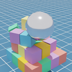
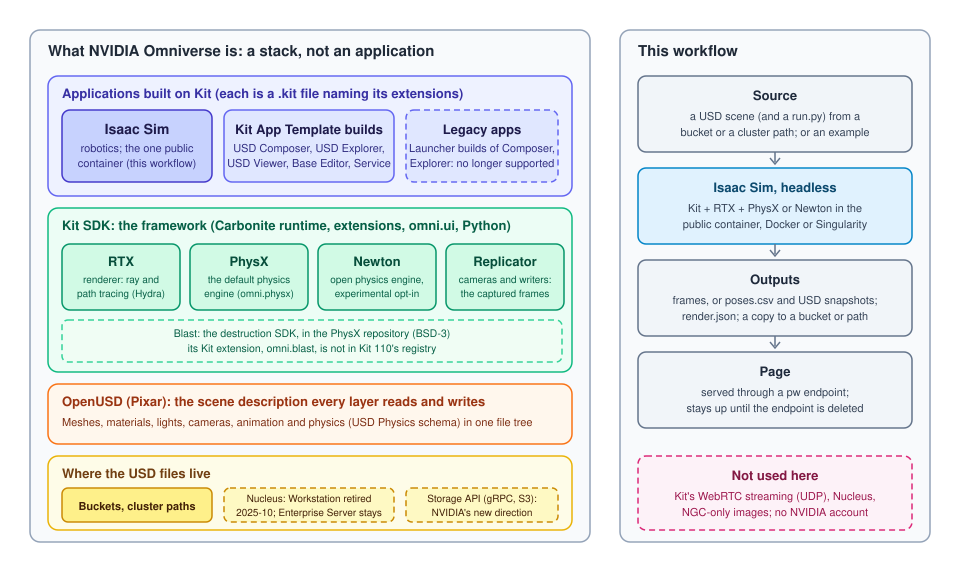

# Omniverse

Runs [NVIDIA Omniverse](https://www.nvidia.com/en-us/omniverse/) on a GPU node of a
cluster: a USD scene is simulated with PhysX or Newton and rendered with the RTX
renderer, or simulated alone, by Isaac Sim running headless in a container, and the
outputs are served as a page through a `pw` endpoint and copied to a bucket or a
cluster path. Four examples show the shapes a run can take; a second variant builds USD
scenes from meshes and robots; a third opens Isaac Sim's own window in a browser
desktop. Nothing here needs an NVIDIA account.

```
form ──► preprocessing ──► start script ──► run.py in the container ──► page ──► https://<endpoint>/
         (checks, the SIF,  (GPU, image,     Isaac Sim: PhysX or Newton,    serve.py      the run completes; the page
          the source copied  cache)           RTX; frames or poses + USD     over the      stays up until you delete
          from the bucket)                    snapshots; render.json         outputs       the endpoint
                                                     │
                                                     └──► a copy to the destination bucket or path
```



## What Omniverse is

Omniverse is not an application you run. It is a stack, and what you run is an
application built on it:



- **OpenUSD** (Pixar's Universal Scene Description) is the file format and in-memory
  model everything reads and writes: meshes, materials, lights, cameras, animation and,
  through the USD Physics schema, "this is a rigid body", "this collides", "this starts
  with this velocity". Every example here is a `.usda` file you can open in a text
  editor.
- **Kit** is NVIDIA's SDK for building applications on OpenUSD: the Carbonite runtime,
  a versioned extension system, the omni.ui toolkit and Python. An application is a
  `.kit` file naming the extensions it loads.
- **RTX** is the renderer Kit drives through Hydra: real-time ray tracing and path
  tracing on RTX GPUs. **PhysX** is NVIDIA's physics engine (open source, BSD-3),
  wrapped by the `omni.physx` extensions and the default in every Kit application.
  **Newton** is the new GPU physics engine (NVIDIA, Disney Research and Google
  DeepMind, Apache 2.0, governed by the Linux Foundation, built on Warp); Isaac Sim 6
  ships it as an experimental opt-in. **Replicator** is the capture layer: cameras and
  writers, which is how this workflow gets its frames. **Blast** is NVIDIA's
  destruction SDK (chunks and bonds), which now lives in the PhysX repository; its Kit
  extension, `omni.blast`, stopped at Kit 104 and is not in Kit 110's extension
  registry, so this workflow uses the SDK directly, at authoring time (see
  [Fracture](#fracture)).
- **The applications built on Kit**: Isaac Sim (robotics, open source), the builds of
  the Kit App Template (USD Composer, USD Explorer, USD Viewer, a base editor, a
  headless service), Audio2Face. NVIDIA files the old prebuilt USD Composer and USD
  Explorer under "legacy, no longer supported": you build them from the template now,
  which downloads the Kit SDK without an account.
- **Why Isaac Sim here**: it is the one Kit application NVIDIA publishes as a
  container anyone can pull anonymously (`nvcr.io/nvidia/isaac-sim`); every image under
  `nvcr.io/nvidia/omniverse/` needs an NGC login. It carries the shared stack this
  workflow uses (RTX, PhysX, Newton, Replicator, the asset converter, the URDF and MJCF
  importers); the robotics parts go unused.
- **Nucleus**, Omniverse's collaboration server, is in transition: the Launcher and
  Nucleus Workstation were retired on 2025-10-01 and their installers withdrawn; the
  Enterprise Nucleus Server remains, free for test and development and licensed for
  production; for new deployments NVIDIA points at its new gRPC Storage API, or plain
  S3. USD files on buckets, which this workflow reads and writes, is the direction.
- **Licensing**: as of May 2026 Omniverse is free for development and production with
  no NVIDIA AI Enterprise subscription; software built with it may be redistributed on
  the same terms; without a subscription, support is community only. Use still means
  accepting the NVIDIA Software License Agreement and the Omniverse product terms, which
  is what the container's `ACCEPT_EULA` does. Running this workflow accepts the
  [Isaac Sim license](https://www.nvidia.com/en-us/agreements/enterprise-software/isaac-sim-additional-software-and-materials-license/).

You do not connect to the NVIDIA application itself in the render variants. Omniverse
applications show their window remotely by streaming video over WebRTC, which runs on
UDP, and a `pw` endpoint only carries web traffic. So the application runs headless,
writes files, and the workflow adds a layer of its own: a small server and page that
serve the outputs through the endpoint. For a live window there is the
[desktop variant](#the-desktop-variant), which puts Isaac Sim's own GUI inside a
browser desktop.

## The examples

| Example | What runs | Outputs |
|---|---|---|
| **Pyramid of blocks** (default) | thirty colored cubes on a floor and a steel ball thrown at them; the throw is the ball's `physics:velocity` in the USD | frames |
| **Fracture** | a 2.4 m wall prefractured into 24 chunks with the Blast SDK, held by 57 breakable joints, hit by a 350 kg steel ball | frames, the count of broken joints |
| **Your scene, as is** | the USD file from the source input, framed from its objects' bounds (a floor is ignored), lit when it has no light, its timeline played | frames |
| **Physics only** | the source's scene (or the fracture wall) simulated with no camera: every body's pose per frame, and the whole stage as USD at intervals | `poses.csv`, `snapshots/frame_NNNN.usda` |

Each example is a directory under `app/examples/<name>/` with a `run.py` and, for the
first two, its `scene.usda`. The scripts share `app/kitrun.py` (the app, the scene, the
orbiting camera, the capture, the physics-only loop, the manifest) and take the same
arguments, so the start script runs any of them the same way: a `run.py` in your source
directory replaces the example's script one for one, and the start script, the page
and the YAML stay as they are. Every run of a bundled scene also copies it to
`render/scene.usda`: open it, change a color or a position, and hand it back as the
source.

The **physics engine** is a form choice: PhysX, Omniverse's default, or Newton. Both
read the same USD Physics schema; Newton is experimental in Isaac Sim 6.2 (1.6.1, the
MuJoCo Warp solver), wants mass and collision geometry on every body and rejects some
PhysX-only traits. The pyramid ran under both on an L4: 1.44 s a frame with PhysX,
1.56 with Newton.

## Files in and out

- **Source** (optional): a bucket URI (`pw://<namespace>/<bucket>/<path>`, `s3://`,
  `gs://`) or an absolute path on the cluster. It names a USD file (`.usd`, `.usda`,
  `.usdc`, `.usdz`) or a directory holding `scene.usd*` (or the one USD file in it),
  whatever it references by relative path, and optionally a `run.py`. A bucket directory
  is copied as a whole into the job directory, so references keep working; a cluster path
  is read in place. Empty runs the bundled example.
- **Destination** (optional): a bucket URI or an absolute path; the outputs are copied to
  `<destination>/<run slug>/` when the run ends, by `pw buckets cp` on the node that
  wrote them. Empty leaves them in the job directory. The page serves the local copy
  either way.

Buckets are the platform's (`pw buckets ls` lists them); the run's own key signs the
transfers, so nothing is configured on the cluster.

## Fracture

`omni.blast`, the Kit extension for Blast destruction, is neither in the Isaac Sim image
nor in Kit 110's extension registry (checked from a headless Kit with the registry
synced). What exists is the Blast SDK itself, BSD-3, in `blast/` of the
[PhysX repository](https://github.com/NVIDIA-Omniverse/PhysX), and it builds on a cloud
login node from source with no account (gcc 11 needs a few warning flags relaxed;
`fracture/build.sh` says which). So the example is prefractured with it:

1. `fracture/blast-fracture.cpp`, built against the SDK's authoring library, cuts a box
   (or an OBJ of yours) into Voronoi chunks and writes them as an OBJ with the cut faces
   marked.
2. `fracture/make-scene.py` (any Python with `pip install usd-core`) turns the chunks
   into USD: each chunk a rigid body with a convex-hull collider and concrete's density,
   and for every pair of chunks sharing a cut face a `PhysicsFixedJoint` at the face's
   centroid that breaks above the face's area times a tensile strength. The ball is a
   sphere with steel's density and an initial velocity.

At run time PhysX does the rest: the joints near the impact break, the pieces fly, the
far ones hold. The fracture script counts the joints PhysX disabled into `render.json`
and the page shows it. Blast's own runtime (bond health, damage programs) is not
involved, which is what Kit 110 leaves available. To fracture a mesh of your own, build
the SDK and the tool once as `fracture/build.sh` describes, then:

```bash
./blast-fracture --out chunks.obj --cells 40 --seed 3 --obj wall.obj
python3 make-scene.py chunks.obj scene.usda --strength 200000
```

## The USD builder

`yamls/general-build.yaml` is a batch job (no endpoint; the run completes when the scene
is written) that assembles a scene from a manifest, headless, in the same container:
meshes (OBJ, STL, FBX, glTF) converted with Kit's asset converter, USD files referenced,
URDF and MJCF robots imported with Isaac Sim's importers, each placed, colored and given
physics properties (rigid, static or none; convex-hull, convex-decomposition or bounding
colliders; mass or density; an initial velocity). The manifest is YAML:

```yaml
scene: yard.usda
objects:
  - name: crate
    file: parts/crate.obj        # relative to the source directory
    position: [2, -0.6, 0.25]
    rotation: [0, 0, 15]         # degrees
    physics: rigid               # rigid, static or none
    collision: convexHull
    mass: 2
    color: [0.91, 0.30, 0.24]
  - name: pendulum
    file: robots/pendulum.urdf
    position: [3.5, 0, 0]
    fix_base: true
```

The whole format is at the top of `app/build.py`. The manifest comes from the form, from
the source directory's `manifest.yaml`, or else the bundled example builds: a ramp, three
crates, a ball rolling down and a two-link pendulum (`app/examples/build/`). The result
is `build/<scene>` with `assets/` beside it (everything it references, by relative
path) and `build.json`; give that directory, or the destination it was copied to, as
the render workflow's source.

## The desktop variant

`yamls/general-desktop.yaml` opens Isaac Sim's own window (the stage, the viewport, the
physics and every extension) inside a KasmVNC browser desktop, from the same SIF. It
calls the [kasmvnc](../kasmvnc/) workflow as a subworkflow with a launcher as the
desktop's startup application; the run completes when the desktop answers, and Isaac
Sim shows its window about three minutes later. Verified on awsgpu (L4, driver
610.43.02): Kit presents its Vulkan swapchain to the VNC X server, 27 fps in the
viewport, without VirtualGL, which NVIDIA's container page says does not work over VNC.
The desktop outlives the run until `pw endpoints delete kasmvnc-<run slug>`.

## Two ways to run it

| Container runtime | What runs | Needs |
|---|---|---|
| **Docker** (the general default) | `nvcr.io/nvidia/isaac-sim:6.2.0.1`, pulled on the node that runs the job, as your user | Docker (directly or through `sudo`), about 35 GB free in Docker's own storage for the image (11 GB to download, 20 GB unpacked) |
| **Singularity** (the hsp and noaa default, the desktop's only one) | The same image as a SIF, `ghcr.io/parallelworks/isaac-sim:6.2.0.1`, pulled once by the login node into the install directory and run by any node as your user | `singularity`/`apptainer`, 11 GB in the install directory |

Both keep Isaac Sim's home (its shader caches and logs) under
`<install directory>/omniverse/cache`, shared by every run on the node, so the shaders
compile once. Singularity is the one for clusters without Docker, or where Docker's
storage sits on a small partition; a kernel that cannot mount a SIF (hardened images
disable squashfs) still runs it in a user namespace, which the log says.

## Form

| Field | Default | Notes |
|---|---|---|
| GPU host | | The cluster; the login node runs the job unless it is submitted to the scheduler |
| Submit to the scheduler, cores per job, GPUs per job, directives | login node, 8 cores, 0 GPUs | A SLURM/PBS job on a GPU node: `--cpus-per-task=N` and `--gres=gpu:N` (PBS `select=1:ncpus=N:ngpus=N`) go ahead of your directives, which can override them. A job gets one core by default and Kit stalls on it; the cloud clusters define no GRES, so 0 GPUs requests none there, and an on-premises cluster that schedules GPUs takes 1. The walltime ends the page |
| Example | pyramid | The [examples](#the-examples) |
| Physics engine | PhysX | PhysX or Newton |
| Frames | 90 | Frames of simulated time at 30 per second; about a second each on an L4 once the shaders are cached |
| Resolution, renderer | 1280 × 720, RTX Real-Time | `RayTracedLighting` (32 passes a frame) and `RealTimePathTracing` are the fast ones; `PathTracing` (64 samples, denoised) takes about 2 s a frame. Hidden for a physics-only run |
| Snapshot every | 30 | Physics only: frames between USD snapshots; 0 writes only the last |
| Scene and script source, results destination | empty | [Files in and out](#files-in-and-out) |
| Container runtime, image, SIF, install directory | Docker, `nvcr.io/nvidia/isaac-sim:6.2.0.1`, empty, `${HOME}/pw/software` | Above; a SIF of your own built with `build-container.sh`; `omniverse/cache` and `omniverse/containers` go under the install directory |

The builder's form has the same host, cluster and software fields, a **Manifest** editor
and a parts source and scene destination; the desktop's has the host and cluster fields,
the **Application** (Isaac Sim with PhysX, or with Newton) and the SIF and install
directory.

## How it works

1. **preprocessing**, on the login node, checks the form, creates the cache directory,
   with Singularity pulls the SIF into the install directory once, fetches the source
   (`app/fetch-source.sh`: a bucket is copied into `scene/`, a path is used in place,
   and the scene file and a `run.py` are found), and assembles the start script
   (`app/create-start-script.sh`: `inputs.sh`, the cleanup trap, `app/start-template.sh`)
   and the scheduler directives.
2. **session_runner** hands the start script to the
   [`script_submitter`](../script_submitter/) subworkflow, which runs it on the login
   node or submits it as a SLURM/PBS job. The script checks the GPU (`nvidia-smi -L`),
   sets up the runtime (`omniverse-<runtime>/runtime.sh`: with Docker, the pull if the
   node lacks the image), runs the example's `run.py` (or the source's) in the container
   with the render directory, the app and the source bound, checks that `render.json`
   and the frames or the poses exist, copies them to the destination when one is given,
   and starts `app/serve.py` under `pw endpoints run`. A failure before that point (no
   GPU, no space for the image, a scene that does not open) fails the run, with the
   output in the run log.
3. **wait_for_endpoint** calls the [`wait_for_endpoint`](../wait_for_endpoint/)
   subworkflow, which polls `pw endpoints list` for `omniverse-<run slug>` and probes
   `render.json` through the platform until it answers; then the run completes and
   the page is left serving.

The builder replaces steps 2 and 3 with one submitter job running
`app/build-template.sh`, which records its exit status in `build.exit`, and a step that
reads it. Cancelling a run while it works removes the container (`cancel.sh`); deleting
the endpoint stops the page.

### The files

```
yamls/general.yaml, hsp.yaml, noaa.yaml                 the render workflow, one per platform variant
yamls/general-build.yaml, hsp-build.yaml, noaa-build.yaml   the USD builder (batch)
yamls/general-desktop.yaml, hsp-desktop.yaml, noaa-desktop.yaml   Isaac Sim's GUI in a KasmVNC desktop
app/kitrun.py                                           what the examples share: the app, the scene, the camera, the capture, the manifest
app/examples/<name>/run.py, scene.usda                  pyramid, fracture, scene, physics; build/ holds the builder's example
app/build.py                                            the USD builder
app/serve.py, app/web/                                  the page and the small server that serves it
app/check-inputs.sh, fetch-source.sh, deliver-results.sh   the form checks, the source copy, the destination copy
app/create-start-script.sh, scheduler-directives.sh     the start script's assembly and the core and GPU requests
app/start-common.sh, start-template.sh, build-template.sh   what every job does on the node; the service; the batch job
app/gui-launcher.sh                                     the desktop's startup command
omniverse-docker/, omniverse-singularity/               controller.sh (the login-node checks and pulls) and runtime.sh (how a script runs in the container) per runtime
fracture/                                               the Blast prefracture tool and the chunks-to-USD scene builder
isaac-sim.def, build-container.sh                       how the Singularity image is built
```

`app/kitrun.py` starts `SimulationApp` headless with the renderer, the resolution and
the engine (Newton through `--/exts/isaacsim.core.simulation_manager/default_engine=newton`
and its two extensions), opens the scene, and for a render creates a Replicator camera
and render product and, for every frame, moves the camera along its circle and calls
`rep.orchestrator.step()` with the timeline playing: the engine advances a thirtieth of
a second, the renderer accumulates its passes and the `BasicWriter` saves
`frames/rgb_NNNN.png`. A physics-only run skips the camera and the writer, reads every
rigid body's pose through the tensor API after each step, and writes the poses back
into the USD transforms before exporting a snapshot.

The real-time renderers use temporal anti-aliasing over 32 passes a frame rather than
DLSS: the NGX library DLSS needs is not part of what the container runtimes hand a
container, and without it the frames come out speckled.

`app/web/` is a static page in the platform's look (the theme tokens and fonts vendored
with `tools/ui/sync-theme.sh`): the frames with play/pause, a slider and the arrow
keys, or the outputs of a physics-only run as a table of links, and what ran them.
`app/serve.py` serves it with the standard library from the node's own `python3`.

## Changing it

- **Your own scene.** Point the source at it (a bucket or a path) and pick *Your scene*,
  or *Physics only* for the poses. Start from the `render/scene.usda` a run writes if you
  want a template. Isaac Sim's own sample assets are not in the image.
- **Your own script.** Put a `run.py` beside your scene; it replaces the example's.
  `app/examples/scene/run.py` is a dozen lines: parse the arguments, start, open, render.
  Replicator's `BasicWriter` can also write depth, normals, segmentation masks and
  bounding boxes, one flag each; that is what Isaac Sim users generate training data
  with.
- **Another animation.** Edit the example's `run.py` or `app/kitrun.py`: `orbit` is the
  camera path, `SUBFRAMES` the passes per frame (fewer render faster and noisier),
  `--fps` the simulated frame rate.
- **Another Omniverse application.** NVIDIA publishes other applications built on the
  same Kit framework: USD Composer, for building scenes by hand, and the bare Kit SDK,
  for writing an application of your own. Their container images
  (`nvcr.io/nvidia/omniverse/usd-composer`, `nvcr.io/nvidia/omniverse/kit`) need an
  NGC account to pull. If you have one, `docker login nvcr.io` on the node, put the
  image in *Container image*, and bring a `run.py` written for that application; the
  scene and Replicator calls are the same, only the launcher differs. The Kit App
  Template builds a Composer of your own without an account, which the desktop variant
  could start in place of Isaac Sim.

## Output and debugging

In the run's job directory on the node (`~/pw/jobs/<run-slug>/` for CLI runs,
`~/pw/jobs/<workflow-name>/<run-number>/` for registered ones):

```
render/frames/rgb_NNNN.png   the frames (a render)
render/poses.csv             frame, time, body, x, y, z, qw, qx, qy, qz (physics only)
render/snapshots/*.usda      the stage with the bodies where they were (physics only)
render/render.json           what ran, and the outputs (the page's data)
render/scene.usda            the bundled scene, when one ran
scene/                       the source, when it came from a bucket
build/<scene>, build/assets/, build/build.json   the builder's outputs
run.<JOBID>.out              the script's output: the GPU, the pull, Isaac Sim's log, the server
<install dir>/omniverse/cache/.nvidia-omniverse/logs/   Isaac Sim's own logs
```

```bash
pw workflows runs logs <slug>            # the whole run
pw workflows runs errors <slug>          # just the failures
pw endpoints list                        # the page's URL
pw endpoints delete omniverse-<slug>     # stop the page (kasmvnc-<slug> for the desktop)
```

The first run on a node compiles the RTX shaders: about two and a half minutes before
the first frame, on top of the 30 to 50 s Isaac Sim takes to start. The caches go to
the install directory, so a later run on that node renders its first frame a few
seconds after starting (60 frames at 1280 × 720 took 133 s in all on an L4).

## Run from the CLI

```bash
pw workflows run "$PWD/workflows/omniverse/yamls/general.yaml" -i '{
  "resource": "pw://<user>/<gpu-cluster>", "cluster": {"scheduler": false},
  "service": {"example": "fracture", "engine": "physx", "frames": 60},
  "files": {"destination": "pw://<user>/<bucket>/omniverse"},
  "software": {"runtime": "omniverse-singularity"}}'

pw workflows run "$PWD/workflows/omniverse/yamls/general-build.yaml" -i '{
  "resource": "pw://<user>/<gpu-cluster>", "cluster": {"scheduler": false},
  "files": {"source": "pw://<user>/<bucket>/parts", "destination": "pw://<user>/<bucket>/scenes"},
  "software": {"runtime": "omniverse-singularity"}}'
```

## Building the Singularity image

```bash
cd workflows/omniverse
./build-container.sh        # the NGC image, its files opened for reading by any user
tools/oras/oras push ghcr.io/parallelworks/isaac-sim:6.2.0.1 isaac-sim-6.2.0.1.sif
```

New Isaac Sim version, new tag, and the tag in `omniverse-singularity/controller.sh`,
`omniverse-singularity/runtime.sh`, `app/gui-launcher.sh`'s default and the forms'
defaults moves with it. Keep the package public.

## Variants

`general`, `hsp` (activate.hpc.mil: the hsp submitter and cluster form, Singularity
by default, the GPU request for GRES-scheduled nodes, the cores through the submitter's
own CPUs-per-task on `existing` resources) and `noaa` (noaa.parallel.works: the noaa
submitter and cluster form; point the install directory at a project or scratch
directory, the homes are small), each with a `-build` and a `-desktop` twin (the
desktop ones call the kasmvnc workflow's variant of the same name). The tests under
`tests/<variant>/` ran on the cloud cluster awsgpu (an L4, SLURM with no GRES): the
login node with Docker and Singularity, a compute node, each example, the engines, a
bucket in and out, the builder, the desktop and the failure path.
