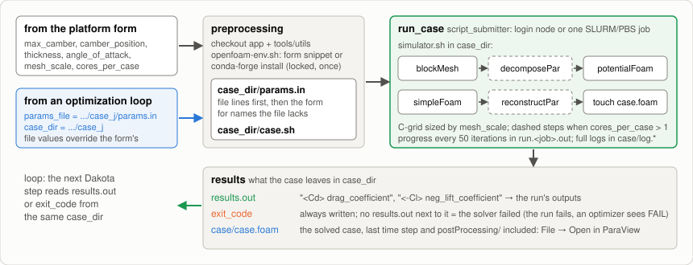
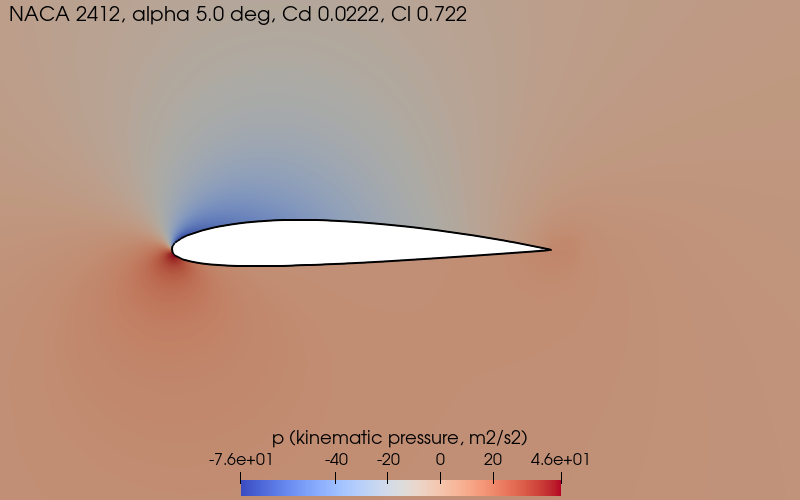
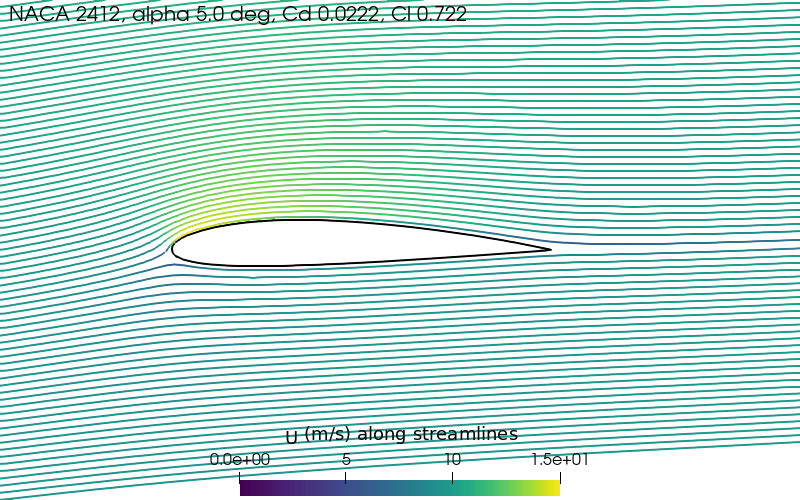
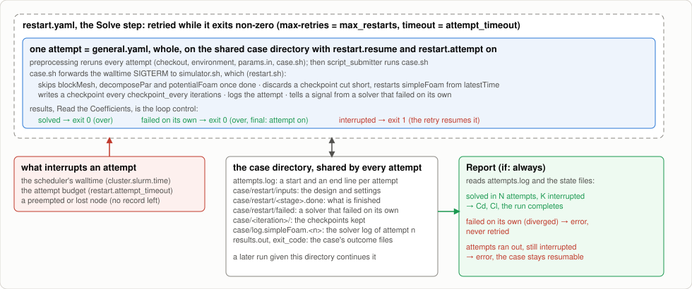

# OpenFOAM NACA Airfoil Case

One OpenFOAM case of a NACA 4-digit airfoil: the workflow meshes the shape you
give it (camber, camber position, thickness) with a structured C-grid, solves the
turbulent flow at the chosen angle of attack (`potentialFoam` + `simpleFoam`,
Spalart-Allmaras, Re = 10⁶), reports the lift and drag coefficients, and leaves
the case ready to open in ParaView. Ask for images and it also renders the
fields with ParaView, on the cluster, without a display.

It runs on its own from the platform, and it is the evaluator of
[`workflows/dakota-openfoam`](../dakota-openfoam/), which calls this same YAML
once per design the optimizer proposes, and of
[`workflows/doe-openfoam`](../doe-openfoam/), which calls it once per sampled
design and shows the images in Design Explorer. Three more variants,
[`yamls/general-restart.yaml`](yamls/general-restart.yaml) and its `hsp` and
`noaa` twins, are the example of a long case interrupted again and again and
resubmitted from its checkpoints until it completes
([below](#resubmitting-an-interrupted-case-the-restart-variants)).



## Inputs

| Group | Input | Meaning |
|---|---|---|
| `cluster` | `resource`, `scheduler`, `cores_per_case`, `slurm`, `pbs` | where the case runs: the login node, or one SLURM/PBS job of `cores_per_case` MPI ranks (`--nodes=1 --ntasks=N`, PBS `select=1:ncpus=N:mpiprocs=N`) |
| `case` | `max_camber` [0, 0.06], `camber_position` [0.3, 0.6], `thickness` [0.08, 0.18] | the NACA digits as chord fractions (0012, 2412, 4412, …); the box where the mesh generator was validated |
| | `angle_of_attack` | incidence in degrees (default 5) |
| | `mesh_scale` 1–6 | multiplies every cell count; cost grows roughly with the cube (table below) |
| | `case_dir` | where to build and solve; empty = `case/` under the run's job directory |
| | `params_file` | a Dakota-style params file (`<value> <name>` per line): **its values override the form fields of the same name**, fields it does not list keep the form's values ([Design names](#design-names)) |
| `postprocessing` | `generate_images` | off by default; on, the solved case is rendered to PNG images with ParaView ([below](#images-of-the-results)) |
| `restart` (hidden) | `checkpoint_every`, `keep_checkpoints` | set by the restart variants or a caller's `with:` block, not from the form: 0 by default (only the last iteration is written); N > 0 writes the fields every N iterations and keeps the last `keep_checkpoints` (2) of them |
| | `resume` | off by default (`case/` is removed and the case solved from scratch); on, a case in the case directory built from the same design and settings is continued ([Checkpoints and resuming](#checkpoints-and-resuming)) |
| | `attempt` | off by default; on only from the restart variants' retried step: a case that failed on its own then completes the run (final) instead of failing it |
| `software` | `openfoam_load` | commands that put OpenFOAM on PATH (`module load openfoam/2412`, `source .../etc/bashrc`); empty installs v2412 from conda-forge under `${service_parent_install_dir:-$HOME/pw/software}/openfoam-naca` (~5 min once) |
| | `paraview_load` | shown with images on: commands that put `pvpython` on PATH (`module load paraview/5.13`); empty downloads the official ParaView 6.1.1 binaries under `.../openfoam-naca/paraview` (x86_64, ~830 MB once, 2.7 GB on disk) |

## Design names

The case reads its design by name. `app/design-parameters.txt` lists the four
names. They are also the `case` fields of the form and the lines of a
`params.in`:

| Name | Form field | Default | Meaning |
|---|---|---|---|
| `max_camber` | Maximum camber | 0.02 | first NACA digit / 100 |
| `camber_position` | Camber position | 0.4 | second NACA digit / 10 |
| `thickness` | Thickness | 0.12 | last two NACA digits / 100 |
| `angle_of_attack` | Angle of attack | 5 | degrees |

The other `case` fields, `mesh_scale`, `case_dir` and `params_file`, are run
settings, not design names. They come from the form only: a params file with a
`mesh_scale` line fails the case, like any other name not in the list.

The **Create the Case** step writes the case's `params.in`. With **Design from a
params file**, it builds it from the file and the form:

- A name the file lists overrides the form field of that name.
- A name the file leaves out keeps the form's value.
- Any other name, or a value that is not a number, fails the case before
  anything runs. The error lists the four names, so a misspelled `max_cambr`
  stops the run instead of solving at the default camber.

So a workflow that calls this one only has to write these names into
`params.in`. For example, [`doe-openfoam`](../doe-openfoam/README.md) and
[`dakota-openfoam`](../dakota-openfoam/README.md) write the names of their
**Design variables**.

## What a run leaves

In the case directory (`CASE_DIR` in the log):

```
params.in        the design the case was solved with (file values merged over the form's)
results.out      "<Cd> drag_coefficient" and "<-Cl> neg_lift_coefficient"
exit_code        the simulator's exit status when it ran to its end, even if it failed; a
                 signal leaves none (a caller reads "neither file" as killed mid-way)
attempts.log     one start and one end line per attempt of the simulator on this directory
run.<job>.out    the streamed log: every OpenFOAM step, one solver progress line per 50 iterations
case/            the OpenFOAM case, final time step included; case/case.foam opens it in ParaView
case/restart/    the state a resumed case continues from (below)
images/          with images on: pressure, velocity, streamlines, turbulence, wake, mesh (PNG),
                 manifest.json and render.log (the full pvpython output)
```

The `results` job publishes `DRAG_COEFFICIENT`, `LIFT_COEFFICIENT`,
`PARAVIEW_FILE` and, with images on, `IMAGES_DIR` as outputs and fails the run
when there is no `results.out` (a diverged solver), printing the log tails.
Reference: NACA 2412 at 5°, `mesh_scale` 1 gives Cd ≈ 0.0222, Cl ≈ 0.722.

### Checkpoints and resuming

The **Checkpoints and Resume** group (`restart`, hidden in the form: the restart
variants and callers set it) makes the case survive an interruption.
`checkpoint_every` N makes `simpleFoam` write its fields every N iterations
(`writeInterval`), keeping the last `keep_checkpoints` of them (`purgeWrite`);
left at 0, only the last iteration is written, as before. `resume` continues
the case found in the case directory instead of removing it:

- the case is only continued when `case/restart/inputs` (the design, `mesh_scale`,
  `cores_per_case` and the other settings that decide the solution) matches; any
  other case there starts over;
- the stages done are skipped (`case/restart/<stage>.done`: `blockMesh`,
  `decomposePar`, `potentialFoam`, `simpleFoam`), and `simpleFoam` restarts from
  its latest **complete** checkpoint (`startFrom latestTime`): a checkpoint a
  kill cut short, one whose fields lack OpenFOAM's closing line in any
  processor directory, is discarded first, and so are all but the last
  `keep_checkpoints`;
- a solved case is not solved again (its results are extracted again), and
  neither is a case whose solver stopped on its own with a non-zero status
  (`case/restart/failed`: a diverged solver is final, not an interruption);
- every run of the simulator is one attempt in `attempts.log`, with a start
  line (from scratch, or what is resumed) and an end line (solved; interrupted
  by which signal at which iteration; failed and why). The solver's log of each
  attempt is kept as `case/log.simpleFoam.<attempt>`.

An interruption is a signal: `case.sh` runs the simulator in the background and
forwards the SIGTERM the scheduler's walltime sends to the batch script alone,
and the simulator (`app/restart.sh`) forwards it to the solver's process tree,
records the interruption and exits 128 + signal. A node lost outright leaves no
record; the next attempt notes that. The attempts hold a `flock` on
`attempt.lock`, so a new attempt waits for the previous one to die.

[`yamls/general-restart.yaml`](yamls/general-restart.yaml) builds on this
group: it calls this workflow from a retried step until the case completes
([below](#resubmitting-an-interrupted-case-the-restart-variants)). The group
also holds the `attempt` flag, on only in that loop, which makes a case that
failed on its own complete the run (final) instead of failing it (interrupted).

### Images of the results

With **Generate images** on, the case ends by rendering its fields to
`images/` with ParaView's `pvpython` (`app/render-images.sh` runs
`app/render-case.py` on `case/case.foam`), on the node that solved it. Six
plan views of the last time step, each labeled with the design and its
coefficients:





| Image | Shows |
|---|---|
| `pressure.png` | kinematic pressure `p` around the airfoil (diverging map, range from the near field) |
| `velocity.png` | velocity magnitude around the airfoil |
| `streamlines.png` | streamlines seeded upstream, colored by velocity magnitude |
| `turbulence.png` | the Spalart-Allmaras eddy viscosity `nut` on a log scale: the boundary layer and the wake |
| `wake.png` | velocity magnitude over the wake, four chords downstream |
| `mesh.png` | the C-grid cells around the airfoil |

Where ParaView comes from: the **ParaView environment commands** of the form
(a site module; any build from 5.10 on), or, left empty, the official 6.1.1
Linux binaries that `app/install-paraview.sh` downloads once per cluster
without root. Those render without a display or any system GL library (the
single Linux build of ParaView 6 falls back to its bundled OSMesa; the
separate 5.13 "osmesa" build needed a system `libglapi.so.0` that minimal
cloud images lack). The renderer names the OSMesa window outright
(`VTK_DEFAULT_OPENGL_WINDOW=vtkOSOpenGLRenderWindow`: VTK's own choice tried
EGL on a node with NVIDIA libraries and no GPU and crashed), falls back to the
build's default backend, then to `xvfb-run` for a build that needs an X
server, and leaves `pvpython` without the interpreter's teardown once the
images are written (its exit hung in the software renderer's threads once);
a render is complete when `manifest.json` exists, whatever the exit status,
and `RENDER_TIMEOUT` (default 900 s) bounds it. The installer renders a test
image the first time, so a node where offscreen rendering cannot work fails
in preprocessing, not in every case. A case whose images fail to render is
still a solved case: the coefficients are on disk first, and the `results`
job prints the renderer's log as a warning. Six images take about 5 s.

### Opening the case in ParaView

ParaView reads OpenFOAM cases through any `*.foam` file in the case directory.

1. Copy `case/` to the machine running ParaView, for example

   ```bash
   scp -r -i ~/.ssh/pwcli -o ProxyCommand="pw ssh --proxy-command %h" \
       <user>@<resource>:~/pw/jobs/<run-slug>/case/case ./naca-case
   ```

   (`pw ssh configure <resource>` writes an SSH config entry instead; the
   `processor*` directories of a decomposed case can stay behind, the workflow
   reconstructs the last time step).
2. **File → Open** `case.foam`, **Apply**, pick the last time step: `p`, `U`,
   `nut`, `nuTilda`. The case is one cell deep in *z*; look at it from +z.

`case/postProcessing/forceCoeffs1/<time>/coefficient.dat` has Cd and Cl per
iteration.

## Cost, accuracy and parallel runs

Measured on gcpsmall for the reference design, one core:

| `mesh_scale` | cells | time | Cd | Cl |
|---:|---:|---:|---:|---:|
| 1 | 5.4k | ~10 s | 0.0222 | 0.722 |
| 2 | 21.6k | ~1 min | 0.0193 | 0.718 |
| 3 | 48.6k | ~3.5 min | 0.0190 | 0.707 |
| 4 | 86.4k | ~10 min | 0.0194 | 0.698 |
| 6 | 194k | ~35 min | 0.0206 | 0.684 |

The mesh is essentially converged by scale 3–4; scale 1 is the demo setting
(~10% high on drag, nearly thickness-blind). The remaining gap to wind-tunnel
data (Cl ≈ 0.74, Cd ≈ 0.010) is the fully turbulent model, not the mesh, so
treat the coefficients comparatively.

`cores_per_case` > 1 decomposes the mesh into N chordwise strips
(`hierarchical`, deterministic; the conda-forge scotch partitions differently
on every call and tips marginal designs into divergence) and runs the solvers
under `mpirun --bind-to none -np N`. It pays from `mesh_scale` 3–4 (4 ranks:
~1.5 min instead of ~3.5 min at scale 3); at scale 1 it is slower than serial.
The sourced environment may `export MPIRUN="srun --mpi=pmix"` to replace the
launcher.

The simulator caps the ranks at one per 1,000 cells (`MIN_CELLS_PER_RANK`, 0
disables the cap) and says so in the case log: 16 ranks on the 5,400-cell base
mesh is 337 cells per rank, and on Nautilus a 5% camber design diverged that way
in under 100 iterations while converging serially, on 4 ranks (1,350 cells per
rank) and on 16 ranks at `mesh_scale` 3, with the Intel and Gcc builds alike
(2026-10-05). So 16 ranks need `mesh_scale` 2 or more to be used in full. A
user-set `MPIRUN` carries its own rank count and is only warned about.

## Resubmitting an interrupted case: the restart variants

A long simulation that keeps being killed and is resubmitted until it
completes. The case is this workflow's airfoil, made to outlast its walltime:
SLURM kills the job at the limit, the loop resubmits it, the solver picks up
from its latest checkpoint, and so on until the case is solved. Preempted
nodes, lost nodes and an attempt that overruns its budget are handled the same
way. It is written as the example for a simulation tool of your own: every
piece a restartable workflow needs is here, in its own place, and the last
part of this section says what to copy for another solver.



| Piece | Where | What it does |
|---|---|---|
| checkpoints | the **Checkpoints and Resume** group → `controlDict` | `simpleFoam` writes its fields every `checkpoint_every` iterations and keeps the last `keep_checkpoints` |
| the run script | [`app/simulator.sh`](app/simulator.sh) + [`app/restart.sh`](app/restart.sh) | resumes from the latest complete checkpoint, skips the stages already done, records every attempt, tells a kill from a solver that failed on its own ([Checkpoints and resuming](#checkpoints-and-resuming)) |
| the signal | `case.sh`, written by preprocessing | passes the walltime's SIGTERM on to the simulator, which stops the solver and records the interruption |
| the loop | [`yamls/general-restart.yaml`](yamls/general-restart.yaml), the `Solve` step (`hsp-restart.yaml` and `noaa-restart.yaml`: the same over those variants, with their cluster forms) | a `retry` block around one call of `general.yaml` per attempt |
| the verdict | [`app/read-results.sh`](app/read-results.sh), the **Read the Coefficients** step of every variant, with the hidden `restart.attempt` on | exit 0 when the case is over (solved, or failed on its own), exit 1 when it was interrupted |
| the report | `general-restart.yaml`, the `Report` step | solved after N attempts, failed on its own, or out of attempts |

### A run

With the defaults the case is a `mesh_scale` 3 airfoil (a few minutes on one
core) and, scheduled, the walltime is 2 minutes, so a run takes two or three
attempts. On the login node the attempt budget is the only thing that
interrupts a case; the saved inputs **login_node_demo** (75 seconds against the
same case) show four attempts. The run log shows only the last attempt under
the `Solve` step (a retried step surfaces only its last attempt); the whole
history is `attempts.log` in the case directory, which the `Report` step
prints:

```
2026-10-16T08:31:46Z  attempt 1  start  from scratch: no case yet
2026-10-16T08:32:51Z  attempt 1  end    interrupted (SIGTERM) in simpleFoam; solver log at iteration 853; checkpoints: 700 800
2026-10-16T08:33:12Z  attempt 2  start  resume; done: blockMesh, potentialFoam; solver log at iteration 853; checkpoints: 700 800
2026-10-16T08:34:17Z  attempt 2  end    interrupted (SIGTERM) in simpleFoam; solver log at iteration 1643; checkpoints: 700 800 1500 1600
2026-10-16T08:34:38Z  attempt 3  start  resume; done: blockMesh, potentialFoam; solver log at iteration 1643; checkpoints: 700 800 1500 1600
2026-10-16T08:35:41Z  attempt 3  end    solved: Cd 0.018992 Cl 0.706550 at iteration 2400 (2496 solved over all attempts); simpleFoam done on attempt 3
2026-10-16T08:36:04Z  attempt 4  start  resume; done: blockMesh, potentialFoam, simpleFoam; solver log at iteration 2400; checkpoints: 2300 2400
2026-10-16T08:36:04Z  attempt 4  end    solved: Cd 0.018992 Cl 0.706550 at iteration 2400 (2496 solved over all attempts); simpleFoam done on attempt 3
```

(the recorded login-node test, run smashing-guppy). Attempt 1 was killed at
iteration 853 with checkpoints at 700 and 800; attempt 2 kept the mesh and the
initialization, restarted the solver at 800, and was killed at 1643; attempt 3
restarted at 1600 and solved the case at 2400, 96 iterations solved twice in
all. Then the budget cut attempt 3 too, during its post-processing, so attempt
4 found the case solved and only extracted the results again: the "never solve
a finished case again" rule at work. The `Report` step then says:

```
::notice::solved in 4 attempt(s), 2 of them interrupted and resumed from a checkpoint: Cd = 0.0189923490, Cl = 0.7065502600 (mesh_scale 3). The history is .../case/attempts.log; open .../case/case/case.foam in ParaView to see the fields
```

and publishes `DRAG_COEFFICIENT`, `LIFT_COEFFICIENT`, `ATTEMPTS`,
`INTERRUPTIONS`, `CASE_DIR` and `PARAVIEW_FILE` as outputs. The two failures
are told apart in the same place: a solver that **failed on its own** (it
diverged) ends the run in error at once, whatever is left of the budget, and a
case **still interrupted when the attempts ran out** ends it in error too but
leaves a resumable case: run the workflow again with `case.case_dir` pointing
at it and the next attempt continues from the latest checkpoint.

### The signal: how a kill becomes a recorded interruption

What SLURM does at the walltime decides most of the design. It sends SIGTERM
to the **batch script alone**, not to its children (verified on gcptest: a
`sleep` started by the script outlived the signal until the SIGKILL 30 seconds
later, SLURM's `KillWait`). The solver would run on, unrecorded, until the
SIGKILL, mid-write or not. So the signal is passed down two steps:

- `case.sh`, the script preprocessing writes (`app/create-case.sh`) and the
  submitter turns into the batch script, runs the simulator in the background
  with a `trap` that forwards SIGTERM, SIGINT and SIGHUP to it, then `wait`s
  (bash runs a trap at once
  while it waits on a background job, only once the command ends while it
  waits on a foreground one). It writes `exit_code` only when the simulator
  ended on its own: a killed case leaves none, which is what `dakota-openfoam`
  reads as "re-propose" and the loop below reads as "resume".
- The simulator (`restart.sh`) runs every OpenFOAM tool through
  `run_interruptible`, the same background-and-wait pattern, and its trap
  forwards the signal to the tool's whole process tree (`mpirun`, its proxies
  and the ranks), remembers it, and ends the attempt with `attempts.log`
  saying *interrupted (SIGTERM) in simpleFoam at iteration N* and exit status
  128 + signal. A signal that arrives between tools ends the attempt before
  the next one starts.

The platform's cancel of an attempt (the budget expired, the run canceled)
goes the same way: the submitter's cleanup `scancel`s the job or kills the
process group, and the trap sees SIGTERM. A node that is preempted or lost
sends nothing: the next attempt finds a start line without an end line and
writes *interrupted without a record (killed outright or node lost)* for it.
Either way, the distinction the loop relies on is simple: **a non-zero status
with no signal remembered is the tool failing on its own**.

### The loop: a retried subworkflow step

[`general-restart.yaml`](yamls/general-restart.yaml) has two jobs.
`preprocessing` checks out the app for the loop's own two scripts and runs the
first, [`app/restart-prepare.sh`](app/restart-prepare.sh), which validates the
form and names the case directory (`case/` under the run's job directory, or
the `case.case_dir` given). Nothing else is needed before the loop, because
every attempt checks out the app, prepares the OpenFOAM environment and
creates the case itself, in `general.yaml`'s own preprocessing; on a cold
cluster the first attempt therefore also installs OpenFOAM, which needs a
budget of a few minutes (an install cut short is removed and redone by the
next attempt). `solve` is the loop:

```yaml
- name: Solve (One Attempt per Retry)
  retry:
    max-retries: ${{ inputs.restart.max_restarts }}   # restarts after the first attempt
    interval: 10s
    timeout: ${{ inputs.restart.attempt_timeout }}     # bounds ONE attempt; defaults to 30 s
  uses: github/parallelworks/workflows@canary
  with:
    $yaml: workflows/openfoam-naca/yamls/general.yaml
    case:
      case_dir: ${{ needs.preprocessing.outputs.CASE_DIR }}
      ...
    restart:
      resume: true
      attempt: true          # hidden: a case that failed on its own completes the sub-run
      ...
```

A retried step re-runs while it exits non-zero, so the sub-run's status is
the loop control, and that status is the status of the first step that fails
in it (a later `if: always` step cannot undo a failed one). Each attempt is
the **entire** `general.yaml` (its preprocessing reruns every time, idempotent
and cheap: the checkout, the environment check, `params.in`, `case.sh`) on the
shared case directory, and its **Read the Coefficients** step, the script
[`app/read-results.sh`](app/read-results.sh) that every variant calls, is where
the verdict is made: `results.out` present, exit 0 (solved, the loop stops); no
`results.out` but an `exit_code`, exit 0 as well when `restart.attempt` is on
(the simulator ended on its own: a diverged solver recorded in
`case/restart/failed`, or a failure before the case was opened such as a bad
input or a missing module on the node; final, the loop stops; without the flag
it is the usual error, which is what every other caller and a standalone run
must see); neither file, exit 1 (killed: the retry fires the next attempt).
**`timeout` is always set**: it defaults to 30
seconds per attempt and cancels the whole attempt, every job of the sub-run,
the scheduler job included. It must cover queue time, node boot (minutes on a
cloud cluster) and the walltime; on the login node it is the only interruption
there is.

### The verdict

The `Report` step ([`app/restart-report.sh`](app/restart-report.sh)) runs
`if: ${{ always }}`, whether the loop stopped by decision or by running out of
retries, and reads the case directory, never the step's status:
`case/restart/failed` is the solver's own failure (error, with the reason and
the log paths), `results.out` with `simpleFoam.done` is success (the
coefficients, the attempt and interruption counts), an `exit_code` without
either is a simulator that failed before opening the case (error: the inputs
or the node's environment, which no retry fixes), no attempt at all is the
case workflow failing before the simulator every time (error: its checkout,
the environment commands), anything else is a case still interrupted after
`max_restarts + 1` attempts (error, with the case directory to resume from).
The run's outputs come from the same files. One
corner: when the budget cuts the last allowed attempt after it has solved, the
`Solve` step ends as failed (its retries are exhausted) and the run with it,
while `Report` prints the solved notice; the notice says so, and the result
stands.

### Inputs of the restart variants

| Group | Input | Meaning |
|---|---|---|
| `cluster` | `resource`, `scheduler`, `cores_per_case`, `slurm`, `pbs` | as above: the login node, or one SLURM/PBS job of `cores_per_case` ranks per attempt. **`slurm.time` defaults to `00:02:00`**, the interruption of the demo; a PBS form sets the walltime in its directives |
| `case` | `max_camber`, `camber_position`, `thickness`, `angle_of_attack` | the design, as above |
| | `mesh_scale` | **default 3** (a few minutes), so the case outlasts the walltime |
| | `case_dir` | empty: `case/` under this run's job directory; an earlier run's case directory continues its case |
| `restart` | `max_restarts` | restarts after the first attempt (the step's `max-retries`), default 10 |
| | `attempt_timeout` | the budget of one attempt (`75s`, `30m`, `2h`), default `30m`: queue + node boot + walltime when scheduled, the only interruption on the login node |
| | `checkpoint_every` | iterations between checkpoints, default 100 |
| | `keep_checkpoints` | checkpoints kept on disk, default 2 |
| `software` | `openfoam_load` | commands that put OpenFOAM on PATH; empty installs it from conda-forge in preprocessing |

Images are not offered here; open `case/case/case.foam` in ParaView as above.
`hsp-restart.yaml` and `noaa-restart.yaml` call `hsp.yaml` and `noaa.yaml` with
those variants' cluster forms (SLURM account, QoS, node type on `existing`
resources); everything else is `general-restart.yaml`'s.

### What a run of a restart variant leaves

In the case directory (`CASE_DIR` in the log, `case/` under the job directory
by default):

```
attempts.log           the history: one start and one end line per attempt
attempt.lock           the lock the running attempt holds
params.in, results.out, exit_code, case.sh, run.<job>.out   this workflow's own files, from the last attempt
case/                  the OpenFOAM case: the last keep_checkpoints time directories, the final one reconstructed
case/restart/          inputs, <stage>.done, failed, solver.attempt
case/log.simpleFoam.<n>, case/log.simpleFoam   every attempt's solver log
```

Every attempt is one `general.yaml` run inside the retried step; the platform
shows only the last one under `Solve`, so read `attempts.log` (the `Report`
step prints it) and the per-attempt solver logs for the earlier ones.

### Tests of the restart variants

Recorded under [`tests/general-restart/`](tests/general-restart/),
[`tests/hsp-restart/`](tests/hsp-restart/) and
[`tests/noaa-restart/`](tests/noaa-restart/), on the cloud cluster `gcptest`
(`pw cluster ls`):

| Test | Interruption | What it checks |
|---|---|---|
| `gcptest-login-node` | the attempt budget: `attempt_timeout` 75 s against a `mesh_scale` 3 case on one core | the platform cancels each attempt, the submitter's cleanup kills the process group, the next attempt resumes; the run completes |
| `gcptest-slurm-mpi2-walltime` | the walltime: `00:02:00` against the same case on 2 ranks | SLURM's SIGTERM reaches the batch script, is forwarded to `mpirun`, the decomposed case resumes; the run completes |
| `gcptest-login-node-diverged` | none: a design that diverges (16 ranks on the base mesh with the rank floor disabled through `openfoam_load`) | the first attempt fails on its own, the loop stops at once, the run ends in error with the reason (`_test.expect: error`) |
| `hsp-restart/gcptest-slurm-mpi2-walltime`, `noaa-restart/gcptest-slurm-mpi2-walltime` | the walltime, as above | the hsp and noaa forms and their `with:` blocks, on a cloud cluster |

```bash
python3 tools/tests/run-workflow-test.py workflows/openfoam-naca/tests/general-restart/gcptest-login-node.json
```

The verdict of each attempt, and of the run, is in `attempts.log` and the
`Report` step; `pw workflows runs errors <slug>` shows the failures. A
`pw workflows runs cancel` of a scheduled run mid-solve was checked by hand as
well: the submitter's cleanup `scancel`s the job, the simulator records the
interruption with its checkpoints, nothing is left on either node, and a later
run given the case directory (`case.case_dir`) resumes from the last checkpoint
and solves it.

### Bringing your own simulation tool

What this example does, and what to do for another solver:

1. **Make the solver write checkpoints**, at an interval that balances lost
   work against write cost, and keep at least two. Decide how your tool tells a
   complete checkpoint from a torn one (a closing line, a checksum, a manifest
   written last, an atomic rename) and check it before resuming.
2. **Make the run script resume**: a fingerprint of the inputs so only a
   matching case is continued; a marker per expensive stage so it is not
   redone; a start-from-latest-checkpoint for the solver; a marker for "solved"
   so a finished case is never solved again; a record for "failed on its own"
   so a diverged case is never retried; one line per attempt in a log. Keep the
   state in plain files next to the case: they are what people read when a
   run looks wrong, and what a later run continues from.
3. **Handle the signal**: find out who receives it under your scheduler (SLURM:
   the batch script only), forward it down to the solver, run long commands in
   the background and `wait` so the trap runs at once, and exit with
   128 + signal. Treat "non-zero and no signal seen" as the solver's own failure.
4. **Keep the case workflow usable on its own** (and by its other callers) with
   resume off, and give it one hidden flag the loop sets, under which the step
   that reads the result completes on a final failure and fails on an
   interruption; then the loop is a retried call of the whole case workflow
   with the case directory as an input and the retry `timeout` sized for the
   whole attempt.
5. **Report from the state files** in an `if: always` step: solved, failed on
   its own, or out of attempts and resumable, and record the tests that
   produced each.

## As a subworkflow

```yaml
- uses: github/parallelworks/workflows@canary
  with:
    $yaml: workflows/openfoam-naca/yamls/general.yaml
    cluster: { resource: ..., scheduler: ..., cores_per_case: ..., slurm: {...}, pbs: {...} }
    case:
      params_file: <iter dir>/case_<j>/params.in    # the proposed design
      case_dir: <iter dir>/case_<j>                  # solve it there
      angle_of_attack: 5
      mesh_scale: 1
    postprocessing: { generate_images: true }       # images/ next to results.out
    software: { openfoam_load: ..., paraview_load: ... }
```

The call leaves `results.out` in `case_dir`, or `exit_code` without it when the
solver failed, which is what an optimizer step reads next, and `images/` when
asked (what `doe-openfoam` shows in Design Explorer). Each call checks out
this app and prepares its environment itself; the installer takes a lock, so
concurrent calls on a cold cluster install once. Worked example:
[`dakota-openfoam/yamls/iteration-naca.yaml`](../dakota-openfoam/yamls/iteration-naca.yaml).

## Files

| `app/` | Role |
|---|---|
| `design-parameters.txt` | the four design names this runner reads from `params.in`; Create the Case checks a params file against it |
| `install-openfoam.sh` | idempotent conda-forge install, the `lib/sys-mpich` link that makes `-parallel` runs load the MPI Pstream, the activation file for `tools/utils/prepare-env.sh` |
| `naca_blockmesh.py` | NACA 4-digit parameters → structured C-grid `blockMeshDict` |
| `openfoam-case/` | the case template: boundary conditions, schemes, solver settings |
| `simulator.sh` | `params.in` → case → `blockMesh` (+ `decomposePar`) → `potentialFoam` → `simpleFoam` → `results.out` → `reconstructPar` + `case.foam`; env contract `MESH_SCALE`, `CORES_PER_CASE`, `MIN_CELLS_PER_RANK`, `OPENFOAM_ENV`, `MPIRUN`, and for checkpoints and resuming `CHECKPOINT_EVERY`, `KEEP_CHECKPOINTS`, `RESUME` |
| `restart.sh` | sourced by `simulator.sh`: the attempts log, the inputs check, the stage markers, the checkpoint check and pruning, the signal trap that stops the solver and records an interruption, the final failure record |
| `create-case.sh` | the **Create the Case** step of every variant: `params.in` from the form and the params file, `case.sh` (the submitted script, which forwards the walltime's signal to the simulator and records its exit status), `CASE_DIR` |
| `read-results.sh` | the **Read the Coefficients** step of every variant: the coefficients as outputs, or the failure with the exit status and the log tails; under `RESTART_ATTEMPT` the loop's verdict |
| `restart-prepare.sh`, `restart-report.sh` | the restart variants' preprocessing (the inputs, the case directory) and `Report` (the verdict from the case's files) |
| `install-paraview.sh` | idempotent download of the official ParaView binaries (`PARAVIEW_VERSION`, `PARAVIEW_URL`), with an offscreen render check, and the activation file for `tools/utils/prepare-env.sh` |
| `render-images.sh` | `pvpython` wrapper: the ParaView environment (`PARAVIEW_ENV`), the backend fallbacks, the timeout, `render.log` |
| `render-case.py` | the pvpython script: `case.foam` (reconstructed or decomposed) → the six images + `manifest.json` |

| `yamls/` | Role |
|---|---|
| `general.yaml`, `hsp.yaml`, `noaa.yaml` | one case, per platform variant |
| `general-restart.yaml`, `hsp-restart.yaml`, `noaa-restart.yaml` | the resubmission loop over the matching variant ([above](#resubmitting-an-interrupted-case-the-restart-variants)); tests under `tests/<variant>-restart/`, the picture `thumbnails/restart-loop.svg` |

Shared: `tools/utils/miniforge.sh`, `tools/utils/prepare-env.sh`,
`tools/utils/check-params.sh` (checks a params file against
`design-parameters.txt`).
